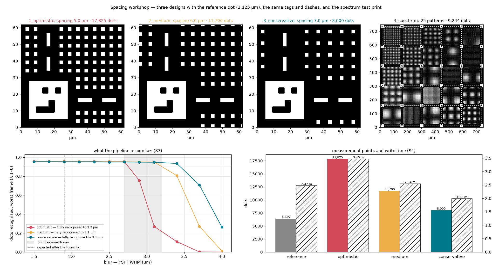

# Nanoscribe marker designs — spacing workshop

*Written 2026-09-29 by `tools/write_design_specs.py`. Every number is read from the design folders.*

Three designs that differ **only in the spacing of the dots**, and one test print that decides
between them. All four are 750 × 750 × 2 µm, 5 × 5 boxes, three tiers — 36 ArUco tags, 480 dashes,
dots — with the reference print's dot (2.125 µm square). Tags, ids and dashes are identical in
all four.



## The four

| folder | dot | spacing | gap | dots | tag | fully recognised up to a blur of | write time vs reference | tightest gap | gate |
|---|---|---|---|---|---|---|---|---|---|
| [`1_optimistic/`](1_optimistic/DESIGN_SPEC.md) | 2.125 µm | **5 µm** | 2.875 µm | **17,825** | 23 µm | **2.7 µm** | 1.40 × | 2.875 µm | PASS |
| [`2_medium/`](2_medium/DESIGN_SPEC.md) | 2.125 µm | **6 µm** | 3.875 µm | **11,700** | 23 µm | **3.1 µm** | 1.03 × | 3.875 µm | PASS |
| [`3_conservative/`](3_conservative/DESIGN_SPEC.md) | 2.125 µm | **7 µm** | 4.875 µm | **8,000** | 23 µm | **3.4 µm** | 0.80 × | 4.875 µm | PASS |
| [`4_spectrum/`](4_spectrum/DESIGN_SPEC.md) | 2.125, 2.5, 3, 3.5, 4 µm | 5 – 8.875 µm | 2.875 – 4.875 µm | **9,244** in 25 patterns | 23 µm | per box | ≈ 1.40 × | 2.875 µm | PASS |
| *reference print* | 2.125 µm | 8.0 µm | 5.875 µm | 6,420 | — | — | 1 | 1.5 µm | — |

Blur measured on the microscope today: 2.7–3.2 µm (PSF FWHM), varying by about a third across the
field; expected after the focus is flattened: about 1.9 µm.

## Which to print

1. **Print `4_spectrum/spectrum.stl` first.** Image it with the whole print in view and run
   `python 4_spectrum/analyse_spectrum.py <image>`. It reports, per box, what was recognised, and
   names the design to print.
2. Print the design it names. If you must choose before the spectrum result:
   - the microscope as it is, unexpanded reference → **Conservative** (margin) or **Medium** (no margin);
   - after the focus fix, or if the first frame imaged is already expanded ~1.5 × → **Optimistic**.
3. For every design: **exposure rising as λ²**, and the detector settings in the design's spec sheet.

## What is in each folder

`DESIGN_SPEC.md` (the design specification) · `spec_sheet.json` + `features.csv` (the spec sheet, for
writing recognition code) · `<name>.stl` and `<name>_merged.stl` (the print, two mesh styles) ·
`reference_tags.json`, `ids.json` (what the pipeline loads) · `verify.json` (the gate record) ·
`render.png` · and, for designs 1–3, `recognition.png`, `printability.json` and the
`test_box*.stl` pair for the DeScribe dry run; for the spectrum, `boxes.csv`,
`analyse_spectrum.py` and `example/`.

## Documents

| | |
|---|---|
| [`docs/00_MASTER_PLAN.md`](docs/00_MASTER_PLAN.md) | the plan, the decisions, the phases |
| [`docs/01_DESIGN_PARAMETERS.md`](docs/01_DESIGN_PARAMETERS.md) | the numbers and where they come from |
| [`docs/02_SPEC_SHEET_FORMAT.md`](docs/02_SPEC_SHEET_FORMAT.md) | the spec-sheet format |
| [`docs/03_SPECTRUM_PRINT.md`](docs/03_SPECTRUM_PRINT.md) | the spectrum print: layout and reasoning |
| [`docs/S3_RECOGNITION.md`](docs/S3_RECOGNITION.md) | what the microscope can recognise |
| [`docs/S4_PRINTABILITY.md`](docs/S4_PRINTABILITY.md) | what the printer is asked to do |
| [`docs/S5_SPECTRUM.md`](docs/S5_SPECTRUM.md) | the spectrum print as built, and its analysis script |

## Still to do — in the lab

| | |
|---|---|
| DeScribe dry run | open `1_optimistic/test_box.stl` and `test_box_merged.stl`; note import, sliced preview, job time |
| calibrate the pixel size | every pixel figure assumes 0.51 µm/px (metadata); the file names imply 0.381 |
| z-stack, flatten the focus | decides how far toward Optimistic the microscope can go |
| print and image the spectrum | names the design |

## Rebuilding

```
python tools/build_designs.py        # designs 1-3 and their gates
python tools/build_spectrum.py       # the spectrum print and its gate
python tools/s3_recognition.py       # recognition test   (4 min)
python tools/s4_printability.py      # printability
python tools/s5_gate.py              # analysis-script gate, writes 4_spectrum/example/
python tools/write_design_specs.py   # these documents
```
