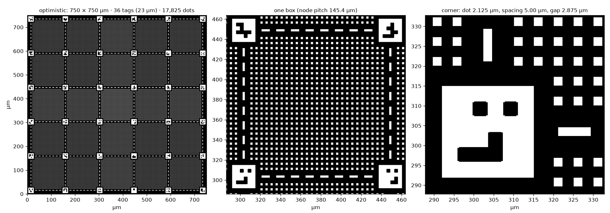
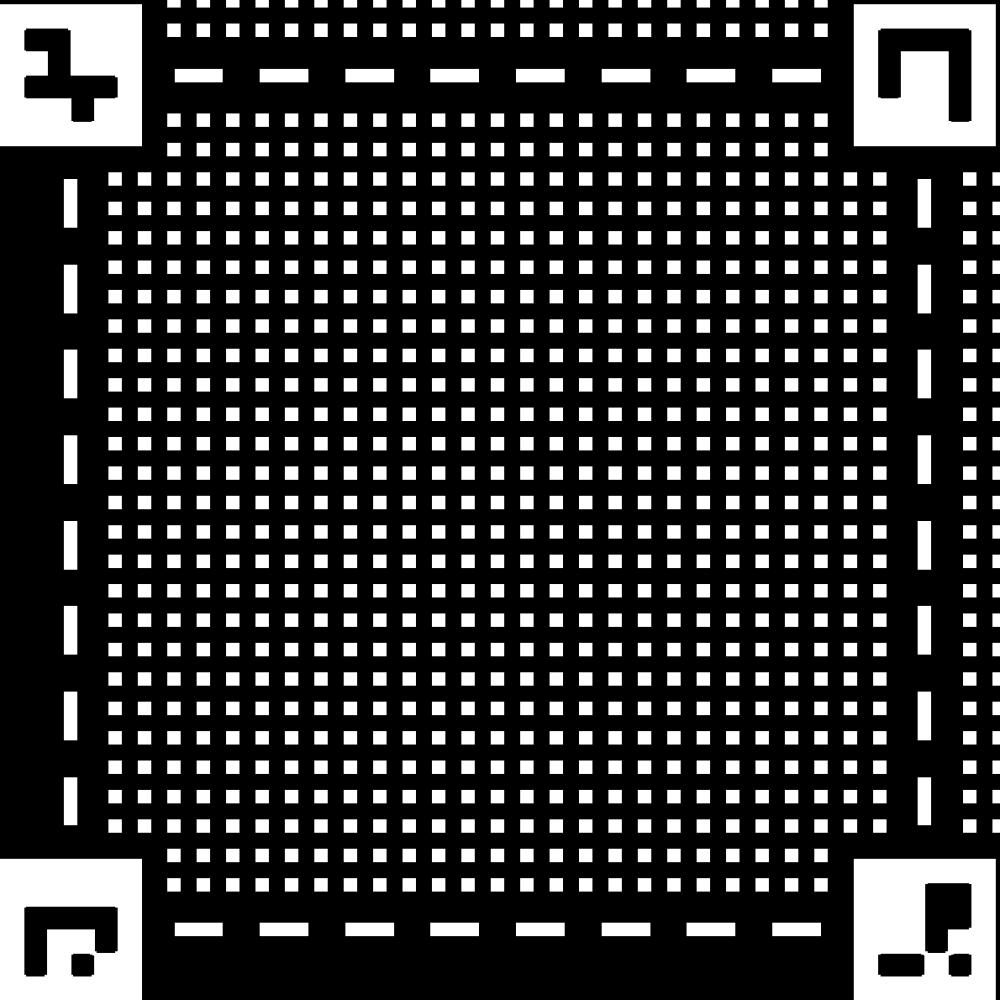
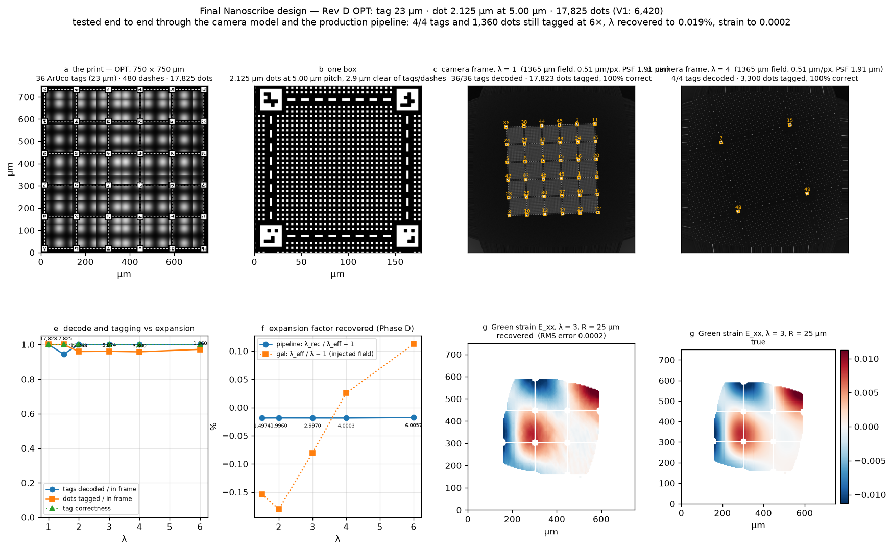

# ArUco Reference Tagger

A Python pipeline to detect, track and measure the deformation of a printed ArUco fiducial marker system embedded in expanding hydrogels, built to compare osmotic expansion microscopy (MAGNIFY) with tensile expansion microscopy (TExM).

## Why

Expansion microscopy enlarges a specimen in a swellable hydrogel so that sub-diffraction features can be resolved on an ordinary light microscope. Every measurement made this way is scaled back by a single expansion factor, which assumes the gel expands isotropically and homogeneously. In practice protocols report 1 to 4 % distortion, and existing checks (registering biological structure with a similarity transform, GelMap grids, manually matched TExM markers) report a single residual number without saying how the distortion is distributed by direction, by position, or over what length scale it is correlated. None has been applied to both osmotic and tensile expansion with the same reference.

This project embeds a reference of known geometry in the gel before gelation and measures the local deformation field directly. Because every marker carries a unique optical identifier, each one is matched to its design position computationally, with no image registration and no manual landmarking.

## The marker system

The pattern is printed by two-photon polymerisation on a Nanoscribe in fluorescent resist and transferred into the hydrogel at gelation. It is a 750 × 750 µm field of 5 × 5 boxes with three tiers of features:

- **ArUco tags** (DICT_4X4_50, 23 µm) at each of the 36 grid nodes. The decoded id gives the node, so every box has an identity and a local frame.
- **Dashes** on the box boundaries, the human-readable grid and coarse strain field.
- **Dots** (2.125 µm, 5 µm pitch, 17,825 per field) filling every box. These are the measurement tier: each dot is addressed as (node, row, column) from the tag ids.

Three gated sizes of the same pattern exist (23, 27 and 34 µm tags), chosen by the measured point-spread function of the microscope. Validated end to end through a calibrated camera model, the 23 µm design still decodes 4 of 4 tags in frame at 6× expansion and recovers the expansion factor to 0.02 %:

## What the analysis does

1. Correct the microscope optics (vignetting, lens distortion, denoise, deskew) and per-image contrast.
2. Decode the ArUco tags, fit the design-to-image transform from their centres, detect and sub-pixel refine the dots.
3. Filter false positives and tag every surviving point with its design identity.
4. Pair the same points across an expansion series by tag.
5. Fit the local deformation gradient around each point from its neighbours and decompose it into rotation and stretch, separating three modes of distortion:
   - **anisotropy**, stretch that varies with direction;
   - **inhomogeneity**, stretch that varies with position;
   - **local warping**, which no locally uniform stretch explains.
6. Map each mode across the gel and report it against the expected expansion factor.

The same markers, imaging and analysis are applied to MAGNIFY (expansion varied by ionic strength) and TExM (expansion varied by iris position) so the two can be compared directly, including at a matched factor of about 4.2×. The detection floor is set first from simulated deformations of known magnitude and from static control samples.

## Repository layout

| Folder | Contents |
|---|---|
| `ArUco_Reference_Tagger/` | The ArUco analysis app, being ported piece by piece from the V1 tagger. |
| `Reference_Warp_Tagger/` | The working V1 app for the earlier glyph-numbered marker print: optics correction, detection, filtering, reference-warp tagging, pairing, overlay, displacement field and expansion summary. The port starts from this code. |
| `ArUco_Tracker_V2/` | Design of the ArUco print: pattern generator, camera simulator, detector prototypes, gating studies, CAD exports and the final design. |

Microscope TIFF frames and simulator outputs are not committed. The six real stitched frames the V1 app was validated on belong in `Reference_Warp_Tagger/Stitched Images/`.

## Project log

Occasional progress updates are posted in [blog/](blog/README.md).

## Status

The V1 tagger is complete and validated on six real frames at 1.5× to 4.2×. The ArUco detector and series driver exist as a headless library inside the V1 code and are tested against the simulator. The port into `ArUco_Reference_Tagger/` is in progress.
