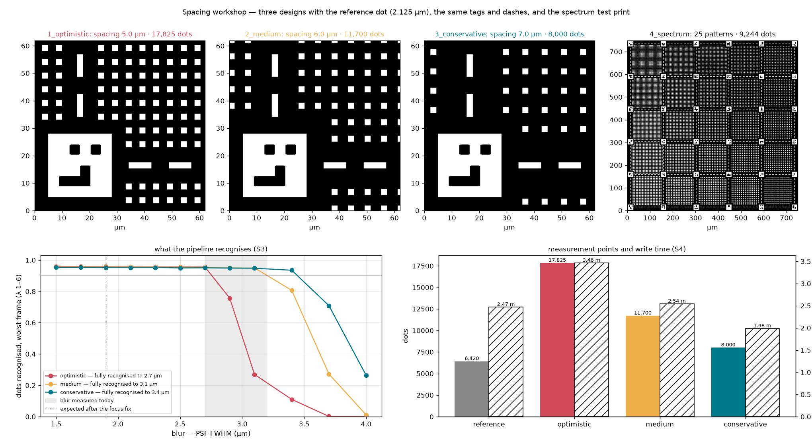
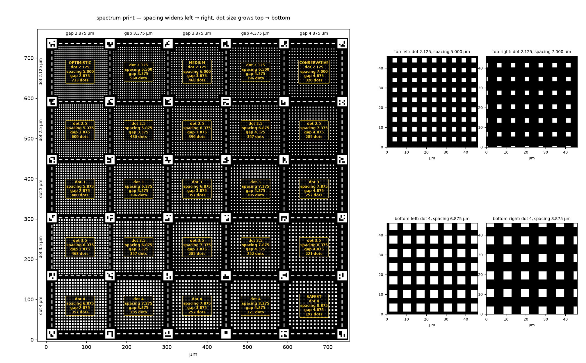

# The Nanoscribe marker workshop: sizing the ArUco print for the real microscope

*2026-10-13*

Before any marker is printed, the design has to fit the microscope that will image it. This post summarises the two workshops that produced the current Nanoscribe design: the ArUco tracker workshop, which sized the tags and the dot lattice against the measured optics, and the spacing workshop, which turned that into three printable designs plus one test print that decides between them. Everything here lives in [`ArUco_Tracker_V2/`](../ArUco_Tracker_V2/); the numbers are from the gated build files and the simulation scripts in `workshop/scripts/`.

## Why the earlier design had to be redone

The first ArUco design (Rev C, July 2026) was sized for a confocal microscope at roughly 100 nm per pixel and a 0.2 to 0.3 µm point-spread function. The instrument actually in use is a widefield system at 0.51 µm per pixel with a measured blur of 2.7 to 3.2 µm. That is five times coarser sampling and about ten times more blur, so every dimension in Rev C (3.5 µm tags, 30 µm boxes, a 3 µm checkerboard) was wrong by roughly an order of magnitude. The method was right, so the workshop reran it with measured inputs instead of assumed ones.

The inputs came from the six real V1 frames and the V1 STL: pixel size, point-spread function and its variation across the field, how dot signal falls with expansion, the minimum resolvable dot separation, and the fact that printed features stay rigid while only their spacing grows.

## The ArUco workshop: what each experiment settled

Each question got one simulation script and one figure (W0 to W11). The design decisions that came out of it:

- **Only the blur matters for dot count.** Going from a 3.18 µm to a 1.91 µm point-spread function doubles the dots per field. The box grid, dictionary and tag size move the count by a few percent at most. The field map showed the blur is worse in the centre than at the edges, which points to sample tilt or doming rather than the objective, so flattening focus is the single lever that decides the design.
- **The decoder, not the pattern, was the problem.** The simulator inherited a CLAHE contrast step from V1. Over a dense dot field it remaps the local histogram until ArUco's dark modules are no longer dark. Removing it took tag decode at the measured blur from 28 % to 100 %, and overturned two earlier conclusions (that tags were half the size they needed, and that the quiet zone was too small).
- **Tag size rule.** Decode needs a module at least 1.45 times the point-spread function. With a 20 % margin that becomes tag = 6 × 1.75 × PSF, giving 23, 27 and 34 µm tags for the three candidate blurs. `DICT_4X4_50` was kept: six modules including the border, and enough strut-free ids for 36 nodes.
- **Error correction has to be switched on.** OpenCV's default `errorCorrectionRate` rounds this dictionary's single correctable bit to zero, so one flipped module loses the tag. Setting it to 1.0 restores 100 % survival of any single payload-module loss. A broken border ring is fatal regardless, so ids were assigned leaf-free first and every diagonal pinch inside a tag is bridged by a 0.2 µm neck with 0.3 µm fillets, which keeps each tag one connected island as the gel swells.
- **Quiet zone is set by the dot detector, not the tag.** ArUco decoded at 100 % with a quarter-module of clearance. What actually fails is a dot merging into a bright tag under the top-hat detector, so the keep-out equals the gap dots already have from each other: pitch minus dot size.
- **Dots beat crosses and saddles.** Rev C suggested checkerboard corners. At this blur a saddle between 2.125 µm squares is not resolved and localises half a micron off. A Gaussian-fitted 2.125 µm dot localises to 0.04 to 0.06 µm and packs two to three times denser, so field precision is two to three times better than a cross. Dot size stays at 2.125 µm, the only size proven to anchor to 4.2× on real gels.
- **Dot pitch rule.** The resolvable separation measured as 1.6 to 1.9 times the imaged dot width at every blur tested, so pitch = 1.75 × √(dot² + PSF²).
- **Exposure must scale with λ².** Signal per dot falls as λ^−1.84. With fixed exposure every dot is lost by 3× expansion whatever its size; with exposure rising as λ² detection stays at 98 to 100 % to 6×. Larger dots do not rescue a fixed exposure, so the 3 µm dot candidates were retired.
- **The decision table.** Running each candidate print against each possible blur, with exposure compensation, gives the rule: measured PSF ≤ 1.9 µm prints OPT, 2.0 to 2.5 µm prints HEDGE, about 3.2 µm prints SAFE. Tags decode in every cell. What fails at the wrong blur is dot separation in the dense reference frame.

The detector requirements that fell out (no CLAHE, error correction on, exclude the un-distortion band at the frame edge, Gaussian-mask dot refinement, noise-floored threshold) are built into `rwtag/aruco` in the V1 code and will carry into the port.

## The spacing workshop: three designs and a test print

With the tag tier fixed at 23 µm, the remaining question is the dot spacing, which depends on the blur the microscope delivers after focus is flattened. Rather than guess, the spacing workshop built three complete designs that differ only in dot spacing, plus a fourth print to decide between them.

| design | dot | spacing | dots per field | fully recognised up to a blur of |
|---|---|---|---|---|
| Optimistic | 2.125 µm | 5.0 µm | 17,825 | 2.7 µm |
| Medium | 2.125 µm | 6.0 µm | 11,700 | 3.1 µm |
| Conservative | 2.125 µm | 7.0 µm | 8,000 | 3.4 µm |
| Reference print (V1) | 2.125 µm | 8.0 µm | 6,420 | |

All three share the same 750 × 750 × 2 µm envelope, 5 × 5 boxes, 36 tags with identical ids, and 480 dashes. Each passed the same gate: exact dot count and geometry, every tag decodes from a render, outer extent exactly 750 µm, zero overlapping features, and a manifold merged mesh for the printer.

### The spectrum print

The spectrum print is the one to print first. Its 25 boxes are 25 different dot patterns: the gap between dots widens left to right (2.875 to 4.875 µm) and the dot grows top to bottom (2.125 to 4 µm). The top row is the three designs themselves at the reference dot size, with two intermediate spacings between them. The bottom-right box, a 4 µm dot at the widest gap, is the safest pattern on the print. The bottom-left, a 4 µm dot at the tightest gap, cannot resolve at any blur under the design rule and is printed as the known-bad corner that shows the test is discriminating.

One design choice matters here. The columns step the edge-to-edge gap, not the centre-to-centre pitch. If they stepped the pitch instead, a larger dot at a fixed pitch would leave a smaller gap and the blur would close it, so nine of the 25 boxes could never resolve and the bottom-right box would be the hardest on the print. Stepping the gap means every column tolerates about the same blur in every row, so reading down a column isolates dot size and reading along a row isolates spacing.

Each box is identified in an image by the four tags at its corners, never by its position in the frame. A script, `analyse_spectrum.py`, takes one image of the print and reports per box the fraction of dots recognised, merged pairs, brightness, scatter about the lattice and the measured blur, then gives one line naming the design to print: the tightest reference-size spacing that is at least 95 % recognised with every wider spacing recognised too. On four synthetic images at known blurs it returns the known answer, and its recognised fraction matches the simulator's truth to within 0.6 % in every box.

The print also answers a question simulation cannot: whether a 3 µm dot prints, anchors and tracks better on the real gel than the 2.125 µm dot. In simulation at 3.4 µm blur the larger dot is recognised better at a given spacing because it is brighter. Rows two to five exist to test that for real.

## Where this leaves things

The design is complete and gated for all three candidates. The choice between them waits on one lab measurement, the point-spread function after focus is flattened, and the spectrum print makes that choice without judgement. Still to do in the lab: a DeScribe dry run of the test boxes, calibrating the pixel size (the metadata says 0.51 µm, the file names imply 0.381), the z-stack to flatten focus, and then printing and imaging the spectrum.

## Next

Port the analysis app so it reads these designs' `reference_tags.json` directly, and run the spectrum analysis on the first real image when it arrives.
