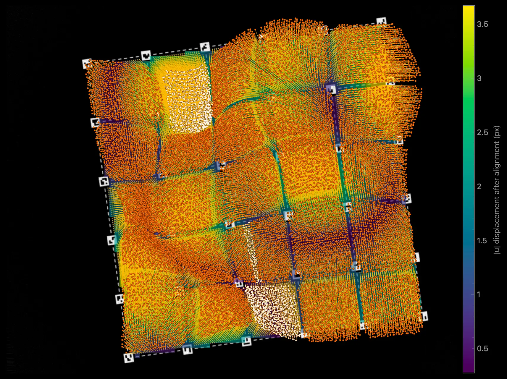
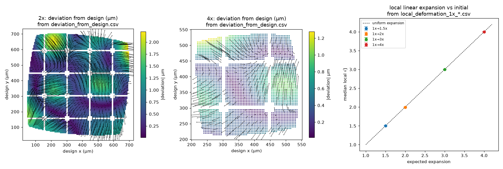

# The ArUco tagger app is built, and tested on fake images with a known answer

*2026-10-15*

The ArUco Reference Tagger is now a working desktop app (Python, PySide6). It takes a series of fluorescence images of one gel at increasing expansion and finds every ArUco tag, dot and dash in each one. It then gives every feature its design identity and an error bar, compares the images with each other, and exports the result as a set of tables for the distortion analysis.

No real images of the V2 print exist yet, so every part of the app was tested on fake images instead. Each fake image comes with the exact position of every feature in it. That makes it possible to check the app against the right answer, not just against what looks plausible. This post describes how the fake images are made and what the tests found. Everything shown here is a check that the app works, not the project's analysis: that comes later, as described below.

*The Field tab on the fake warped series. Each orange dot is one printed dot, and its line is how far that dot moved between two images once the expansion and rotation are taken out, coloured by size in pixels. The swirls are the distortion that was deliberately added to the fake images. The square markers are the ArUco tags. This is a visual check that pairing and alignment work, not an analysis result.*

## What the app does

The app has eight tabs, one per step:

1. **Correct** the optics: lens distortion, uneven illumination, and tilt of the whole image.
2. **Detect** every ArUco tag with its position and rotation, and every dot and dash. The tag ids register the image to the design directly.
3. **Filter** out detections at the edge, too close to a tag, or off the lattice.
4. **Tag** every kept feature with its design identity (for example `dot|B7|3_12`), and accept or reject the image.
5. **Pair** two images by identity.
6. **Overlay** two images, with or without the expansion removed.
7. **Field**: the displacement and local deformation between two images, shown in the screenshot above.
8. **Series**: every image against the first one on one colour scale.

Each image also has a metadata panel for objective, laser, exposure, date, gel, and whether cells are present. Most of these are read from the TIFF header automatically.

The **Export bundle** button writes one folder holding every feature's position in each frame of reference with its error, the deviation from the design grid, the tag poses, the local deformation between image pairs, and every setting used. A script can produce the same folder without the GUI, and on the test project its tables are byte-for-byte identical to the GUI export.

## How the fake images are made

The generator is `projects/aruco-marker-design/tools/make_dummy_series.py`. It builds an image the way the microscope would see a real print, one physical effect at a time:

1. **The print.** It starts from the same design file the Nanoscribe prints from, so every tag, dot and dash is where the real print puts it. An optional setting adds a fixed random placement error to every feature, the same in every image, as a real print would have.
2. **The gel.** The features are moved as rigid islands: each one keeps its printed size while the spacing between them grows by the expansion factor. That is how a printed marker sits on an expanding gel.
3. **Distortion.** For the warped series, 14 smooth bumps of displacement are added, each about 90 µm wide and up to 2 µm strong, growing with the expansion. The first image is left undistorted, so it acts as the reference.
4. **Handling.** Each image gets its own rotation of the gel (between −4° and +5°) and a random shift of up to 8 µm. This is like remounting the sample between images.
5. **Drawing.** The scene is drawn at twice the camera resolution with exact area coverage, so a feature's edge can fall partway through a pixel.
6. **The microscope.** The image goes through a barrel lens distortion, a 55 % fall-off of illumination toward the corners, and a blur matching the design's optics (1.91 µm wide for the optimistic design). It is then reduced to the camera's 0.51 µm pixels over a 1365 µm field.
7. **The camera.** Brightness is converted to photons with random shot noise, then read noise and a background are added. The result is saved as a 16-bit TIFF.
8. **The header.** Each TIFF gets a standard microscopy (OME) header with a made-up objective, laser, exposure time and acquisition date. This tests the app's metadata reading too.

For every image the generator also writes the exact position of every feature. Positions are recorded both before and after the lens distortion, along with each tag's corners and rotation. The camera gain is recorded too, but deliberately left out of the TIFF header, because real cameras rarely record it.

Several standard series test different things:

| series | what it tests |
|---|---|
| clean | expansion only: the app should find no distortion |
| warped | rotation, shift and the added distortion: the app should recover the distortion |
| noise | ten repeat images of one state, for calibrating the error bars |
| print error | a fixed placement error per feature, which should cancel when comparing images |
| no lens | the lens correction switched off |
| spectrum, spectrum blurred | the per-box dot sizes of the spectrum design, sharp and blurry |
| conservative, dim | the larger design with dim high-expansion images |

Building a good fake image took some care. The first version rounded every feature to the nearest drawing pixel. That moved each feature by up to a quarter of a camera pixel, differently in every image: a jitter three times larger than the app's real measurement error. The app's error bars flagged it, because they did not match how much positions actually moved between repeat images. The generator now draws with exact coverage. A second, smaller slip was a lens centre a quarter pixel off the image centre, now recorded in the truth file.

## What the tests found

There are 97 automatic tests, run on these fake series. The main results:

| check | result |
|---|---|
| ArUco tag ids read correctly | 100 %, no wrong ids |
| Dot position precision | 0.050 px per axis, as the error model predicts |
| Dots whose error ellipse contains the true position | 96 to 98 % (95 % expected) |
| Added distortion recovered between two images | to 0.046 µm, correlation 0.999 |
| Distortion relative to the design grid recovered | to 0.018 µm |
| Expansion factor | within 0.05 % |
| A mirrored image | rejected |
| GUI export vs the script export | identical tables |

*Plotted only from the exported tables of the warped series. Left and middle: each dot's deviation from the design grid at 2× and 4×, in design micrometres. Right: the median local expansion against the first image, which sits on the line for uniform expansion.*

## This is a working check, not the analysis

None of the figures in this post are research results. The images are fake, and the plots are rough views that exist to confirm the machinery works. They show that tags are read, dots are found and named, the same dot is matched across images, and the distortion that was put in comes back out. The point is to see that the pieces fit together before any real data goes through them.

The Pair, Overlay, Field and Series tabs are built for the same purpose. They let me look at the data before exporting it, to catch a mismatched pairing, a misplaced grid or a bad image by eye. They are deliberately simple. They show one quantity at a time, for two images at a time, with no statistics across gels or between expansion methods.

The real analysis is separate and not written yet. It will read the exported tables and do the work the project is about:

- measure local anisotropy and how it varies across the gel;
- measure how distortion is correlated over distance;
- compare gels expanded by MAGNIFY (osmotic) with gels expanded by TExM (tensile);
- treat the noise properly, for example the small positive bias anisotropy has even when there is no distortion.

The app's job ends at the export. It turns images into named, positioned features with honest error bars, and it does that the same way every time.

## What fake images cannot show

The fake images are kinder than real ones. They have no debris, no cells, no patchy staining, no out-of-focus regions, and a lens that follows a textbook model exactly. The results above show the app measures correctly when its assumptions hold. They do not yet show how it copes when they don't.

## Next

Print the V2 markers, image a first real series, and run it through the app. The error bars need calibrating on ten or so repeat images of a real, unexpanded gel, and the camera gain needs finding. After that, the exported tables go to the downstream analysis comparing MAGNIFY and TExM.
