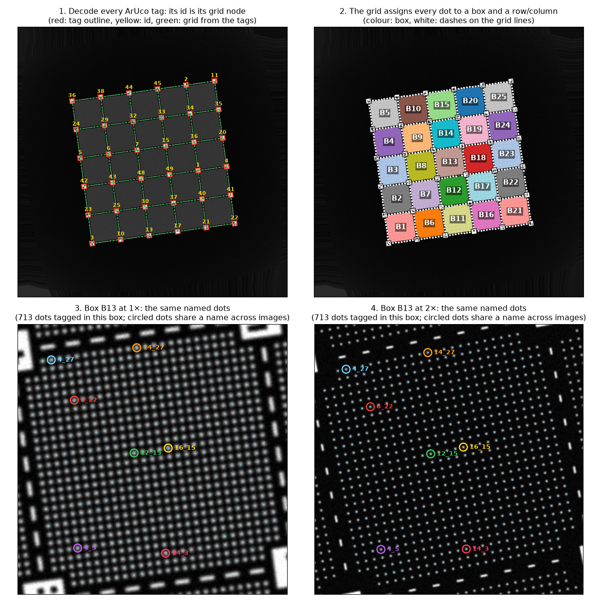

# How pairing works, and why everything depends on it

*2026-10-15*

Every measurement this project wants is a comparison of the same printed dot in two images. If a dot sits at one place before expansion and at another after, the difference between the two positions is the measurement. Local stretch, anisotropy, rotation and distortion all come from these differences, combined over neighbouring dots.

That only works if the app knows, for certain, which dot in the expanded image is which dot in the original. This step is called **pairing**. This post explains how the ArUco markers make it possible and why getting it right matters more than any other step.

## Why pairing is hard on a dot lattice

The optimistic design prints dots 2.125 µm wide on a 5 µm grid: about ten camera pixels apart before expansion. Every dot looks exactly like its neighbours. Between two images the gel expands, rotates and shifts, so a dot can move hundreds of micrometres while its neighbours sit only 5 µm apart.

The obvious approach is to pair each dot with the nearest dot in the other image. It fails as soon as anything moves more than half a grid spacing, which is always. Even after a rough alignment, a lattice of identical dots has an ambiguity: shifting the whole match by one row or one column fits almost as well as the right answer. The result is a pairing that looks plausible and is wrong everywhere by exactly one grid step.

That error would be disastrous. The distortion signal we are looking for is a few tenths of a micrometre. A one-step mistake puts a 5 µm error into every affected dot, and a block of slipped dots looks exactly like real local strain.

The V1 print tried to solve this with printed digits in each box, read by a character recogniser. On dim, high-expansion images the recogniser struggled. Three of the six real V1 images needed a geometric rescue from a lower-expansion image. The V2 print replaces the digits with ArUco markers for this reason.

## Step by step: from markers to named dots

*Taken from the fake warped series, as a visual check of each step. 1: every ArUco tag decoded, with the grid the tags define. 2: every dot assigned to a box. 3 and 4: one box at 1× and at 2×, with seven dots circled by name. The circled dots are the same physical dots in both images.*

### 1. Read the ArUco markers

There is an ArUco marker at every corner of every box: 36 markers on a 6 × 6 grid of nodes. Each carries a unique id, and the design file records which grid node each id sits on. Decoding a marker therefore says exactly where in the print that part of the image is. No other image is needed, and it does not matter how far the gel has expanded or rotated.

The decoder also records how confident each read is. It counts how many bits had to be corrected, how close the read came to a different id, and whether the marker reads better mirrored. A mirrored marker means the image is flipped, and the app rejects the image instead of pairing it wrongly.

### 2. Build the grid from the markers

With at least three markers decoded, the app fits a map from design coordinates (micrometres on the print) to image pixels. It fits through the marker centres, not their corners. The reason is that each marker is a rigid printed island: it keeps its printed size while the spacing between markers grows with the gel. The fit gives the image's expansion, rotation and handedness, and draws the grid of box boundaries over the image (panel 1).

If only one or two markers are in view, which happens at high expansion, the app still registers the image. It takes rotation from the marker's own corners and the expansion from the spacing of the dot lattice.

### 3. Assign every dot to a box

The app detects every dot, separately for each printed dot size. Each dot's position is mapped back through the grid into design coordinates, which tells the app which of the 25 boxes it belongs to (panel 2). Boxes are numbered B1 at the bottom left, up each column. Detections at the image edge, too close to a marker, or off the lattice are set aside with a reason.

### 4. Give every dot its name

The grid from the markers is a straight-line map, and a real gel does not expand perfectly evenly. So the app refines it. Starting from the marker grid, it fits a smooth warp of the whole design onto the detected dots. The warp bends with the gel, which keeps every design dot within a fraction of a grid step of its real position, even where the gel has distorted.

Each detected dot then takes the name of the nearest design dot under that warp. Three rules protect the result:

- the match must be closer than 0.45 of the box's dot spacing;
- each design dot can be claimed once;
- the dot's box from step 3 must agree with the name's box.

A dot that fails any rule is set aside as unmatched, never given a guess. Dashes on the box edges are named the same way along their grid lines, and markers are named by id.

The name records exactly where the dot is in the print. For example, `dot|B13|12_15` is the dot in box 13, column 12, row 15. Every image of the gel gets its own set of names, worked out independently from that image alone.

### 5. Pair by name

Once every image is named, pairing is a simple join: the dot called `dot|B13|12_15` in one image is paired with the dot of the same name in the other. There is no search between images and no distance threshold. Large expansions, rotations or shifts between images do not matter.

Because each image is named against the design, any image can be paired with any other. This includes 1× with 4×, or 2× with 3×. The markers do the hard part once per image, and pairing never has to guess.

## What happens after pairing

Pairing gives two positions per dot, each with its own error. From those, the app:

- **aligns** the two images, either keeping the expansion (rigid) or removing it (similarity), so the remaining movement is growth plus distortion or distortion alone;
- computes each dot's **displacement** and its error, combining both images' position errors and the alignment's own uncertainty;
- fits the **local deformation** around each dot from its eight nearest paired neighbours, giving the local stretch, the two principal stretches, their direction, the anisotropy and the local rotation, each with its error.

Pairing also cancels one problem. A real print has its own small placement errors, so a dot may be printed slightly off its design position. That error is the same in every image of the gel, because it is the same physical dot. Comparing two images subtracts it out, while comparing an image against the design does not.

## How well it works on the fake images

On the fake series described in the [previous post](2026-10-15-gui-built-and-tested-on-dummy-images.md), each named dot was checked against the generator's true position:

| series | dots named correctly | dots named wrongly |
|---|---|---|
| clean, 1× to 6× | 100 % in every image | 0 |
| warped, 1× to 6× | 100 % in every image | 0 |
| conservative, dim, 1×, 3× and 6× | 99.9 % | 0 |

The few unnamed dots were set aside, not mislabelled. No dash or marker was given a wrong name, and every marker in view was read.

| pair | dots paired |
|---|---|
| 1× with 2× | 13,491 |
| 1× with 4× | 3,389 |

At 4× and 6× only four markers fit in the field of view, yet every image registered and paired.

These are fake images, so the 100 % shows the logic is sound, not that real images will be as clean. Real images will bring dim regions, debris and missing markers. The app is built to set a doubtful dot aside rather than guess its name. In the downstream analysis, a missing dot costs a little data, but a wrong pair would corrupt the result.

## Next

Image a first real series of the V2 print and look at the Pair tab, which shows paired and unpaired dots, before trusting anything downstream.
