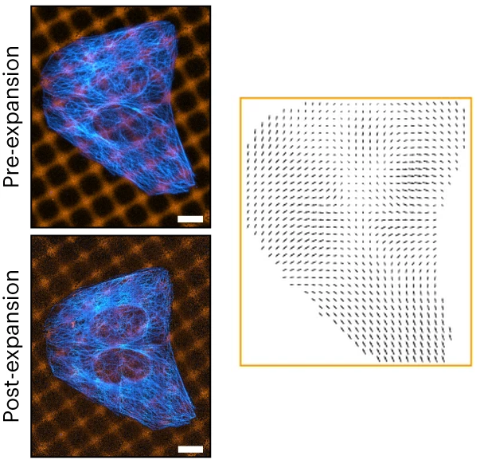
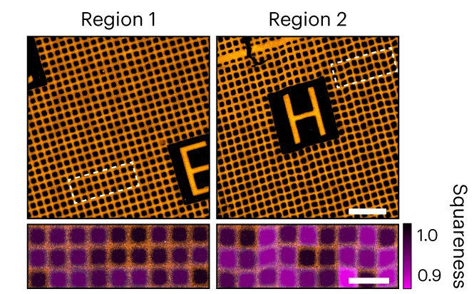
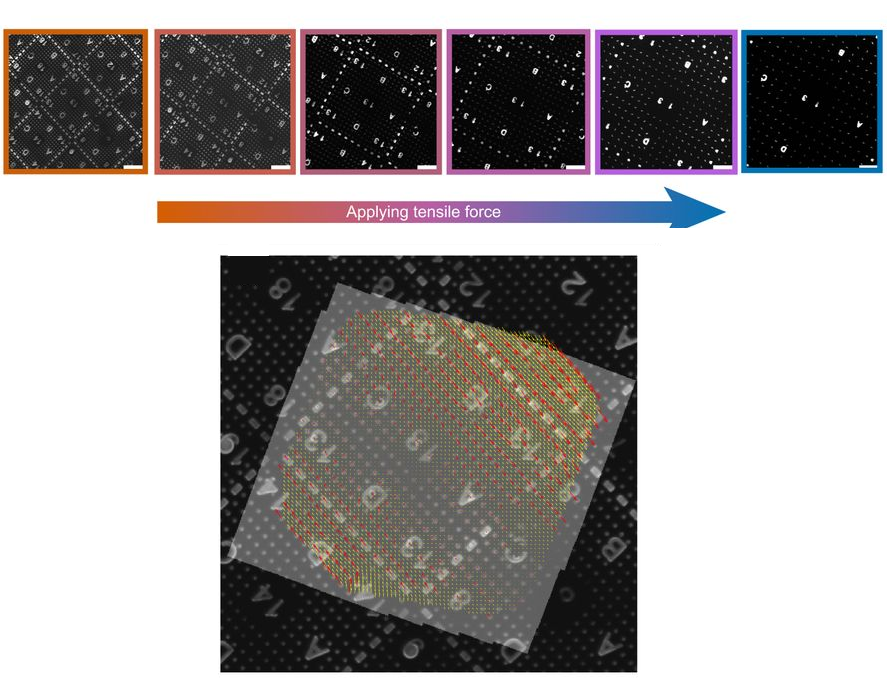

# The research proposal: what the markers are for

*2026-10-30*

The earlier posts were about the markers and the software: how big to print them, how each dot gets an error bar, how dots are named and paired. This post steps back to the science they serve. It is a plain-language version of my senior project proposal, *Quantifying Expansion Anisotropy in Osmotic and Tensile Expansion Microscopy: A Comparison of MAGNIFY and TExM*, written with my mentors Vignesh Venkataramani and Lydia Kisley.

The full proposal, with its LaTeX source and references, is in [`proposal/`](../docs/proposal/) ([PDF](../docs/proposal/research_proposal.pdf)).

## The question in one paragraph

Expansion microscopy (ExM) embeds a sample in a hydrogel and swells or stretches the gel, so that features smaller than the diffraction limit (about 250 nm) can be resolved on an ordinary microscope. Every length measured this way is divided by one number, the expansion factor, to get the true size. That only works if the gel grows by the same amount in every direction and at every position. Published protocols say the error is 1 to 4 %, but report it as one residual number. Nobody has measured *how* the distortion is structured: which direction it points, where in the gel it sits, over what distance it is correlated, and whether two different ways of expanding a gel distort it differently. This project measures that, for osmotic expansion (MAGNIFY) and tensile expansion (TExM), using the same printed reference in both.

## Two ways to expand a gel

- **Osmotic swelling (MAGNIFY).** The sample is anchored to a charged gel and digested or denatured so it does not resist expansion. In water, charge repulsion and osmotic pressure swell the gel in all three dimensions. How evenly it swells depends heavily on how well the sample was homogenized; leftover structure can resist swelling or crack the gel.
- **Tensile expansion (TExM).** Developed in our lab. A tough double-network gel is stretched by an iris-like device whose nine arms grip the gel's edge, giving repeatable expansion up to 4.2×. Stretch acts only in the plane of the gel, and strain enters through the grips rather than everywhere at once, so its distortion may have a different shape from osmotic swelling.

## How distortion is measured today, and what is missing

Every method compares some reference before and after expansion.

| method | reference | what it reports |
|---|---|---|
| most protocols, including MAGNIFY | the cell's own structure, registered with a similarity transform | one root-mean-square length error |
| pan-ExM | same, but also fits an affine model | error drops from ~3 % to 1.6 %, so about half the distortion is direction-dependent stretch, which was not characterized further |
| GelMap | a lithographically printed protein grid | a local expansion factor and a "squareness" score per grid square |
| TExM | rigid two-photon-printed fluorescent markers, matched by hand | one global distortion value |

 

*Left: a cell before and after expansion, with the deformation field from registering its microtubules. Right: an expanded GelMap protein grid, each square coloured by how much it is deformed. Both adapted from Damstra et al., GelMap, Nature Methods (2023), Fig. 2, under CC BY 4.0.*

*Printed fluorescent markers after tensile expansion, registered to the pre-expansion pattern by a similarity transform. Red: residual mismatch. Yellow: interpolated deformation field. Adapted from Venkataramani et al., TExM, bioRxiv (2026), Fig. 2e.*

Two gaps stand out:

1. **The numbers cannot be compared across techniques.** Each method uses its own reference, model and metric, and none has been applied to both osmotic and tensile expansion. Some are also tied to the chemistry: GelMap's protein grid is itself digested during homogenization, and registering biological structure only works where there are clear, well-labelled features.
2. **They measure how much, not what kind.** A similarity fit folds direction-dependent stretch into one residual. GelMap's score combines stretch and skew. pan-ExM found an anisotropic component but did not describe it.

## Objectives

**1. Printed markers in MAGNIFY and TExM gels** (end of fall semester). Design and print a self-identifying fluorescent marker pattern, transfer it into both gels, and confirm the markers stay anchored and fluorescent before, during and after expansion. Acquire expansion series in both systems before the lab closure.

**2. Analysis pipeline with quantitative distortion metrics** (spring break). Extend the marker pipeline (this repo) to measure local deformation and split it into anisotropy, inhomogeneity and local warping. Establish the smallest distortion it can detect, then compare both techniques across expansion factor.

**3. MAGNIFY and TExM with cells** (end of senior year). Expand cells alongside the markers in both systems and use the marker deformation field to judge how faithfully each technique preserves cellular structure, including at a matched expansion factor. Compare a shortened digestion with the standard one to see how homogenization affects anisotropy.

## Methods in brief

**Markers.** The pattern is printed by two-photon polymerization (Nanoscribe) in fluorescent resist on glass, and each gel is cast over it. Three pass/fail tests come first in each gel: the markers release from the glass, stay anchored in the gel, and survive that gel's chemistry. The [marker workshop post](2026-10-13-nanoscribe-marker-workshop.md) covers how the pattern was sized.

**Imaging.** Widefield fluorescence, before, during and after expansion where possible. Expansion factor is varied by ionic strength in MAGNIFY and iris position in TExM, and measured from the markers themselves. Planned datasets: a MAGNIFY series with at least three gels per condition, swelling time-lapses, controls (static gels and a known stretched elastomer), and a TExM series up to 4.2×.

**Cells.** Cells are grown directly on the printed coverslips, so cells and markers sit in the same gel. They are fixed, stained for microtubules in a separate channel from the marker dye, anchored (AcX for TExM, MAGNIFY's own chemistry), and homogenized with the standard or a shortened digestion. Comparing each cell's local expansion with the marker field at the same spot shows how much of the distortion comes from the gel and how much from the sample.

## The analysis goals

This is the part the code in this repo is being built for.

### 1. Find and name every marker

ArUco markers are decoded with OpenCV. Because each marker's id links it to its design position, deformation is measured directly against the design, with no image registration (see [how pairing works](2026-10-15-how-pairing-works.md)). Analysis stays inside a single Nanoscribe write field, since stitching between fields could look like distortion. A similarity transform (uniform scale, rotation, translation) fit to all markers gives the global expansion factor.

### 2. Fit the local deformation gradient

For each marker $i$, with design position $\mathbf{X}_i$ and measured position $\mathbf{x}_i$, the local deformation gradient $\mathbf{F}_i$ is the 2×2 matrix that best maps its $k$ nearest neighbours' design offsets to their measured offsets:

$$
\mathbf{F}_i = \arg\min_{\mathbf{F}} \sum_{j=1}^{k} \left\| (\mathbf{x}_j - \mathbf{x}_i) - \mathbf{F}\,(\mathbf{X}_j - \mathbf{X}_i) \right\|^2
$$

Changing $k$ changes the length scale of the measurement.

### 3. Split off the rotation

$\mathbf{F}$ is split into a rotation $\mathbf{R}$ and a stretch $\mathbf{U}$:

$$
\mathbf{F} = \mathbf{R}\,\mathbf{U}, \qquad \mathbf{U} = \sqrt{\mathbf{F}^{\mathsf{T}}\mathbf{F}}
$$

The eigenvalues of $\mathbf{U}$, $\lambda_1 \ge \lambda_2$, are the principal stretches. Rotation does not distort anything and is discarded. Perfect expansion means $\mathbf{U} = \lambda\mathbf{I}$ everywhere.

### 4. Three distortion metrics

| mode | meaning | metric |
|---|---|---|
| **anisotropy** | stretch depends on direction | $A = \lambda_1/\lambda_2$ |
| **inhomogeneity** | stretch depends on position | coefficient of variation of the local expansion factor $\sqrt{\det\mathbf{F}}$ across the gel |
| **local warping** | deformation no locally uniform stretch explains | residual of the $\mathbf{F}$ fit |

Each is mapped across the gel.

### 5. Spatial structure: can it be corrected?

Smooth, large-scale distortion can be corrected after imaging; short-range distortion cannot. To tell them apart, the fluctuation of the local expansion factor, $\delta\lambda = \lambda - \langle\lambda\rangle$, is autocorrelated:

$$
C(r) = \frac{\langle \delta\lambda(\mathbf{x})\,\delta\lambda(\mathbf{x}+\mathbf{r}) \rangle}{\langle \delta\lambda^2 \rangle}, \qquad r = |\mathbf{r}|
$$

The correlation length $\xi_c$ is where $C$ falls to $1/e$. It says how densely a sample must be referenced for its distortion to be corrected.

Two more checks:

- **Orientation.** Are the directions of maximum stretch random, or aligned along a preferred axis (for TExM, perhaps toward the grips)?
- **Comparison with the literature.** Root-mean-square length error against measurement length, the number other protocols report.

### 6. Detection limit first

Before any comparison, the smallest detectable distortion is set from simulated deformations of known size and from the control datasets. The [fake image series](2026-10-15-gui-built-and-tested-on-dummy-images.md) is the start of this.

## What I expect to see

- **Structured, not random, distortion in MAGNIFY.** Osmotic protocols report 1 to 4 % length errors over tens to hundreds of micrometres, and pan-ExM put about half of its error down to direction-dependent stretch.
- **Homogenization matters.** Where digestion leaves structure behind, swelling is locally resisted, so expansion should vary with position, and with direction where that structure is oriented.
- **The two techniques distort differently.** MAGNIFY through short-range variation tied to the sample and gel; TExM through larger-scale, direction-dependent stretch radiating from the nine grips.
- **The distortions are small.** TExM reports under 12 µm of distortion across 1.3 mm², and pilot data show the local expansion factor varying by only 1 to 3 % (coefficient of variation). I expect anisotropy of a few percent at most ($A \lesssim 1.05$), with distortions above about 10 % only in visibly damaged regions such as tears. The method's estimated detection limit is well below 1 %, so effects this size should be clearly resolvable.

## Why it matters

Every ExM measurement is converted to true size with one expansion factor, so the technique is only as good as that assumption. Knowing how the remaining few percent is structured, and especially its correlation length, tells users how densely a sample must be referenced to correct it, and when a correction can be trusted. The printed markers and the openly released pipeline could also become a common calibration standard for any expansion protocol, including TExM, which has none yet. And because the markers are not made of protein, they are not digested, so they stay a fair reference even in experiments that vary homogenization itself.

## Risks

The main risk is a marker failing a transfer test: not releasing from the glass, not anchoring, or not surviving the chemistry. Fallbacks are silanizing the printed features to improve anchoring, swapping dyes if fluorescence does not survive, and a reserved second print session. If imaging during expansion proves impractical, the study uses equilibrium images and sets aside the question of equilibration time.

## Next

Run the three transfer tests on the V2 print in both gels, then image a first real MAGNIFY series.
