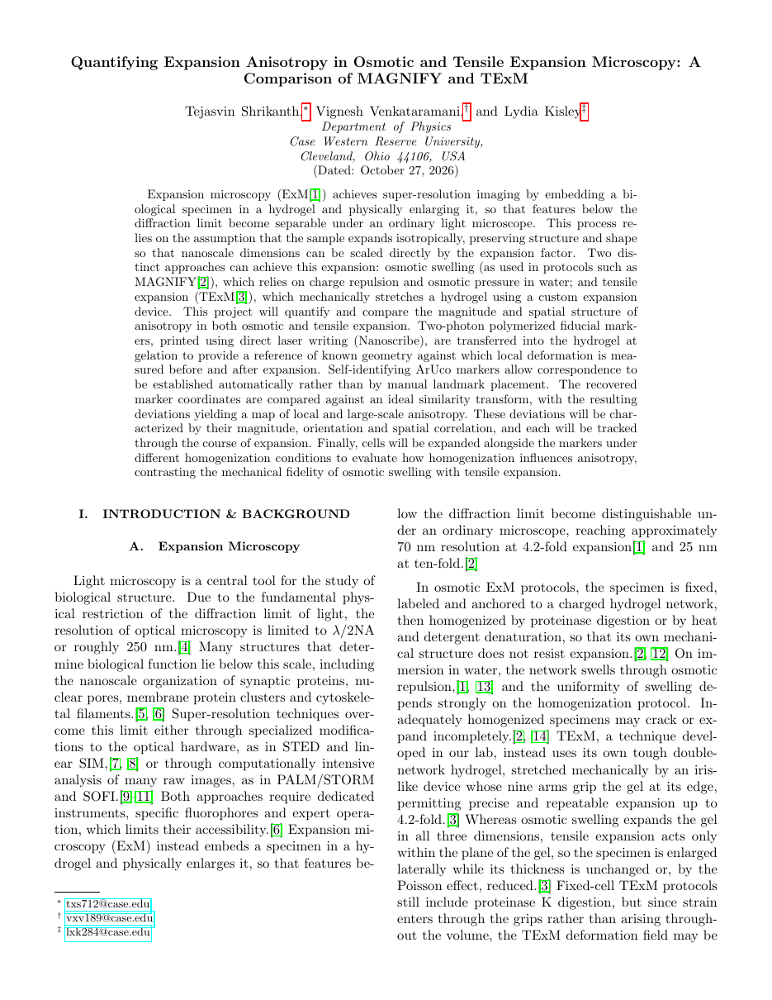
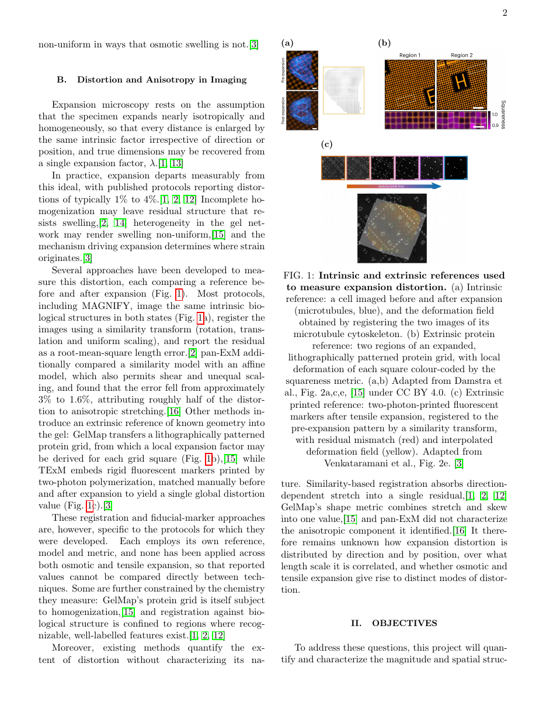
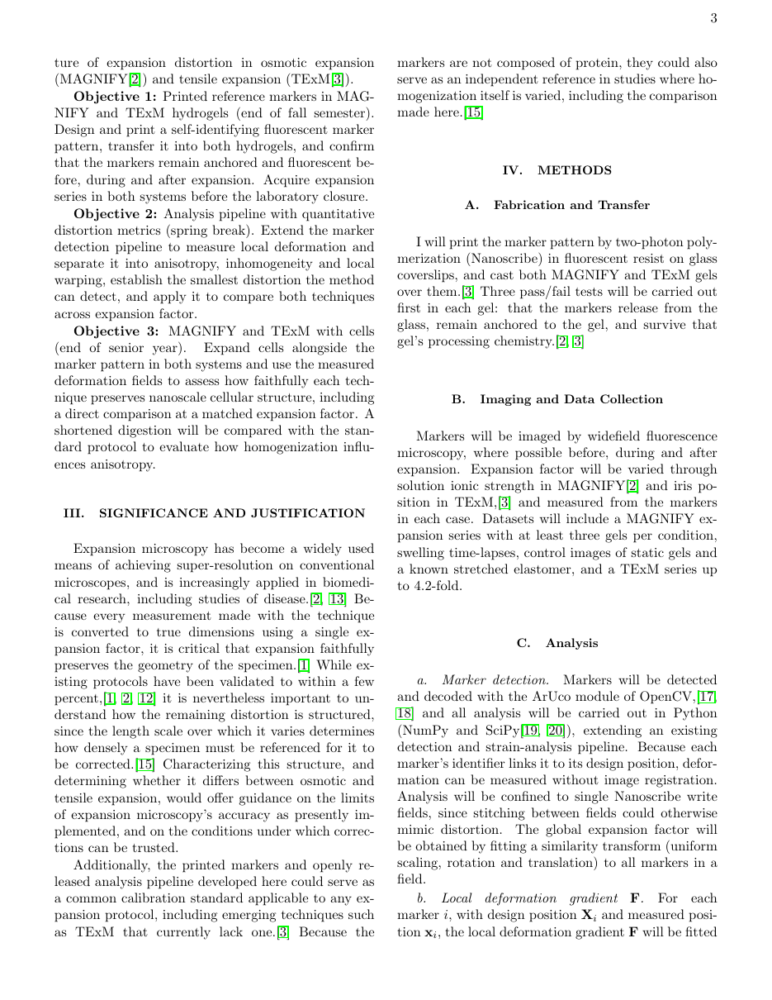
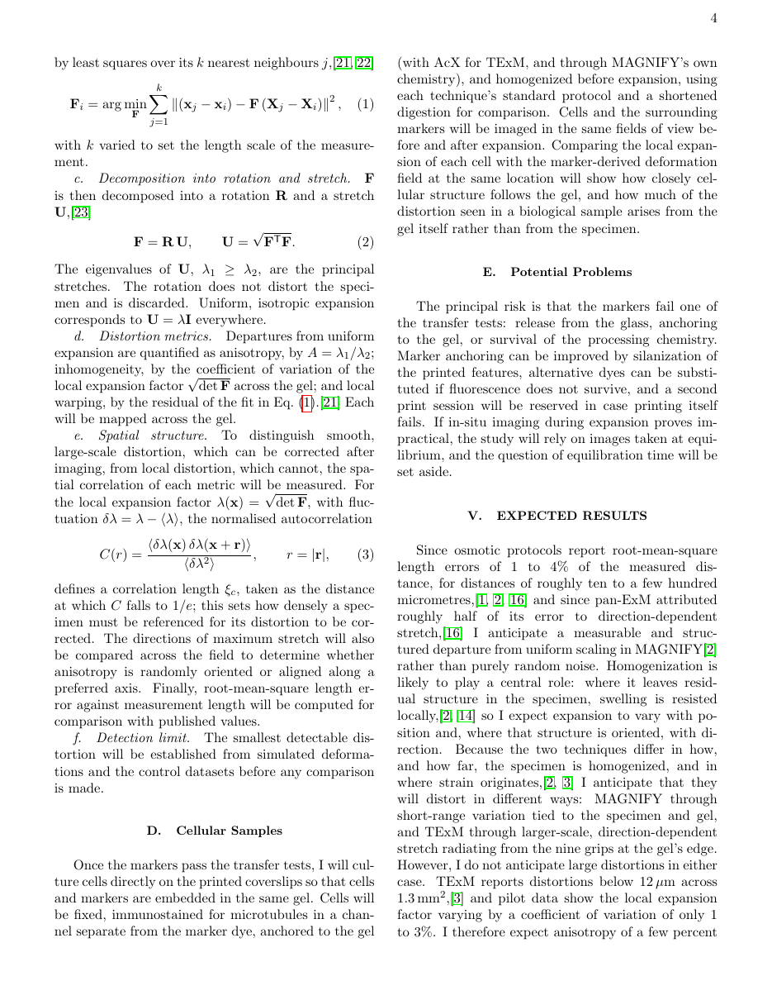
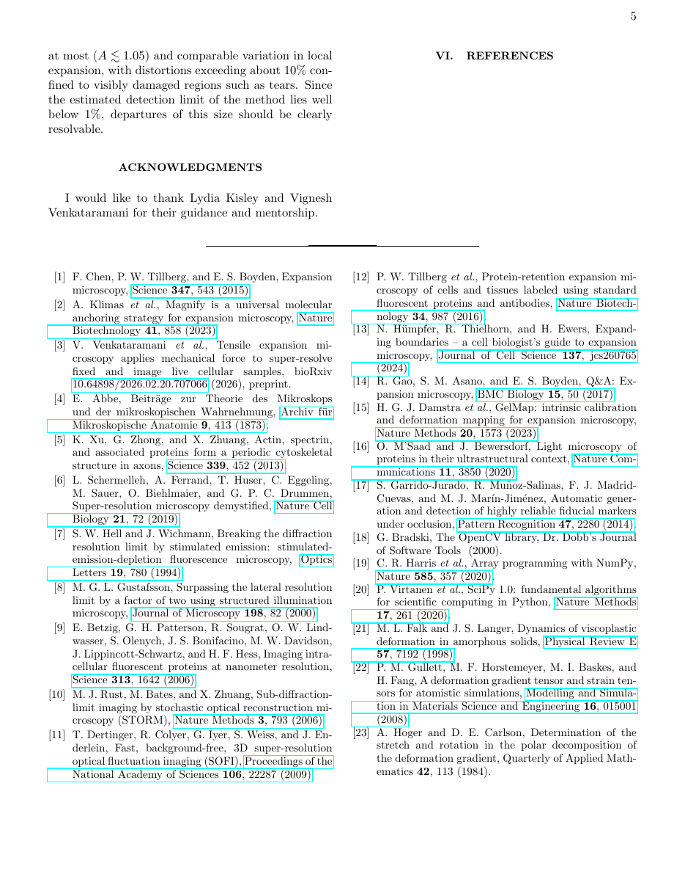

# Research proposal (full PDF)

*2026-10-30*

The full text of my senior project proposal, *Quantifying Expansion Anisotropy in Osmotic and Tensile Expansion Microscopy: A Comparison of MAGNIFY and TExM*, written with my mentors Vignesh Venkataramani and Lydia Kisley (Department of Physics, Case Western Reserve University), dated October 27, 2026.

**[Download the PDF](../proposal/research_proposal.pdf)** · [LaTeX source](../proposal/) · [plain-language summary](2026-10-30-research-proposal-anisotropy.md)

The five pages are shown below. Citation numbers refer to the reference list on page 5; links inside the page images do not work, so use the PDF to follow them.

