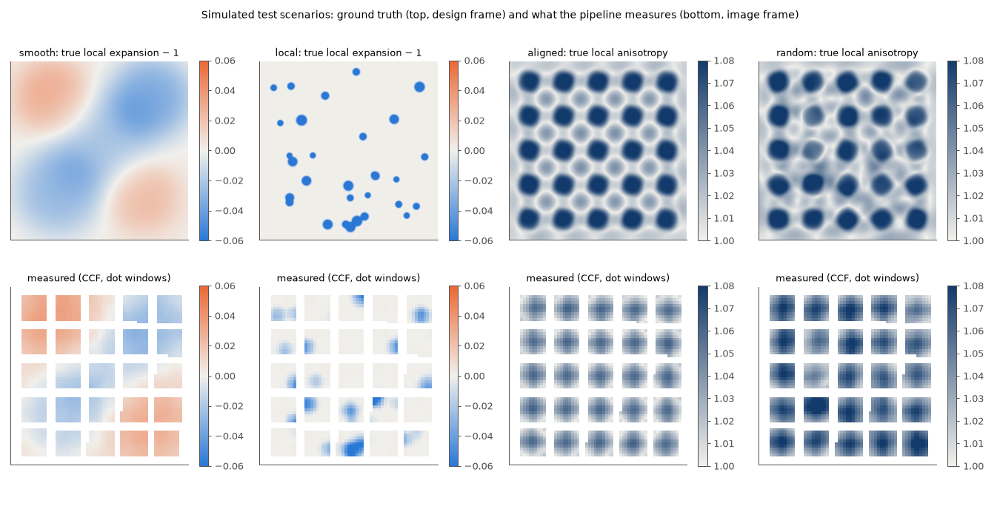
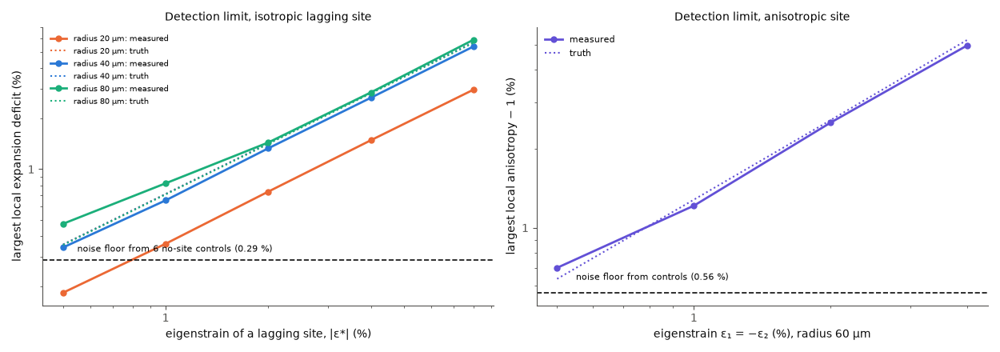
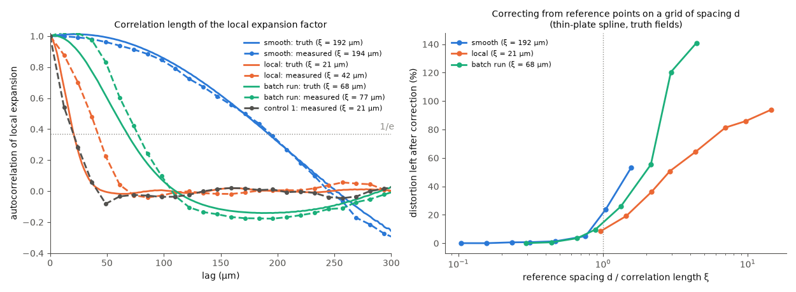
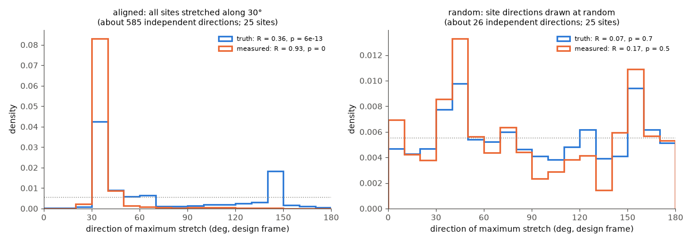
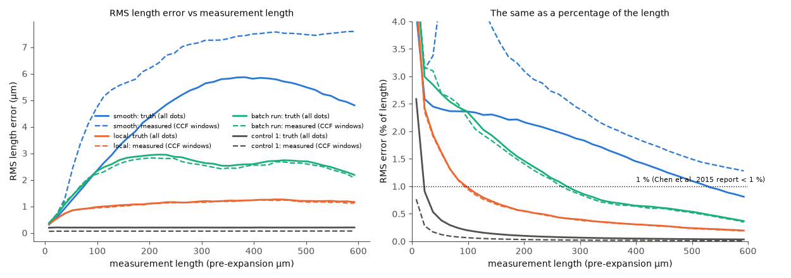

# Test workshop: can we detect spatial structure in a distortion? (simulated images only)

*2026-10-30*

> **This post is a test workshop, not a result.** Every image in it is simulated, and every distortion was put in on purpose. The only question here is whether the methods I plan to use *can* detect spatial structure in a distortion when I know exactly what is there. Nothing below says anything about how real gels behave. Where a number looks like a finding, read it as "the method can see this much" or "the method fails here".

The plan for the analysis has a step I call *spatial structure in the distortion*. After measuring how much a gel distorts, I look at how that distortion is arranged in space:

- **Correlation length.** The autocorrelation of the local expansion factor gives a correlation length. It says how densely a sample must be referenced for its distortion to be corrected: smooth distortion can be corrected, local distortion cannot.
- **Stretch directions.** Are the directions of maximum stretch random or aligned?
- **RMS error against length.** The usual expansion microscopy measure, so the numbers can be compared with published values.
- **Detection limit.** Set it first, from simulations and controls, before any real data.

Before trusting any of that on real gels, I wanted to see each step work, and fail, on fake images where the answer is known. This post describes the new tool built for that and what the test workshop found.

## What was built: the ExM Distortion Explorer

The new code lives in `ArUco_Reference_Tagger/exm_explorer_prompt/` on the `exm-explorer` branch. It grew out of the earlier batch simulation and has three parts so far.

1. **A gel model.** I place "sites" on the real fiducial grid: elliptical patches where the gel wants to expand differently from the rest, for example 12 % less, or 5 % more along one axis and 5 % less across it. A linear-elastic solver then works out how the whole gel moves around those patches. As before, every printed dot, dash and ArUco tag is a rigid island that keeps its printed size; only the islands' centres move.
2. **The analysis from the batch run, ported and tested.** This covers the ACF, the dot-lattice fit, the tag-centre registration, and the windowed lattice-aware cross-correlation (CCF) with unwrapping. On the batch run's own images it reproduces the earlier numbers to the fourth decimal. A fast path renders the expanded image straight into the pre-expansion frame, which is quick enough to update while a site is being dragged.
3. **A desktop app.** It shows the pre image with every site drawn as an ellipse you can drag, resize and rotate. The true displacement, local expansion, anisotropy and rotation are drawn on top and update as you drag. The app also marks **maxima and minima** of whichever map is shown, with a minimum separation and a minimum deviation from the reference value so that noise bumps are not reported. Clicking a row in the list of extrema centres the view on it. The ACF and CCF panels come next.

None of this has touched a real image yet.

## How the test workshop was run

Every case below went through the full pipeline, the same as the batch run:

1. render the pre (1×) and post (4×) images exactly, with shot and read noise;
2. decode the ArUco tags with OpenCV and fit the global transform from the tag centres;
3. resample the post image into the pre frame;
4. run the windowed CCF (64 px windows, 24 px apart) and get local expansion and anisotropy from plane fits over 5 × 5 windows.

I used only windows holding dots. Windows with a tag or a dash give biased answers in this method, because those features are much larger than the blur and keep their printed size while the dot lattice grows. That was found and agreed during the build.

There were 30 runs in all, about two minutes on a laptop:

| case | what was put in |
|---|---|
| 6 controls | no sites at all, six different noise and jitter draws |
| smooth | five broad patches, 140–200 µm across, ±3 to ±5 % |
| local | thirty small lagging patches, 12–22 µm across, −12 % |
| aligned | 25 anisotropic patches (±6 %), all stretched along 30° |
| random | the same 25 patches, stretch directions drawn at random |
| batch run | the three lagging patches of the earlier batch simulation |
| detection sweep | one patch of radius 20, 40 or 80 µm and strength 0.5 to 8 %, plus an anisotropic patch of 0.5 to 4 % |

*Simulated test scenarios only. Top: the distortion that was put in. Bottom: what the pipeline measured from the simulated images. The blank strips are windows with a tag or dash, which are left out. This is a check of the method, not data.*

## 1. Controls first: the detection limit

The six no-site controls set the noise floor, because anything the method reports there is not real.

| control measurement | value |
|---|---|
| CCF displacement error, dot windows | 0.047 px rms (0.024 µm) |
| local expansion, scatter | 0.049 % rms |
| local expansion, largest value in any control map | 0.29 % |
| local anisotropy, typical bias with no distortion | 0.10 % |
| local anisotropy, largest value in any control map | 0.56 % |

The anisotropy bias matters. With no distortion at all, noise alone makes the measured anisotropy slightly above 1, because anisotropy can only be positive. A site counts as **detected** only when its signal is larger than anything seen in all six control maps.

*Simulated sweep. Each point is one simulated gel with one patch. The dashed line is the largest value seen in six simulated no-site controls. Dotted lines are the true values at the window positions.*

| simulated patch | weakest detected |
|---|---|
| isotropic, radius 20 µm | 1 % (0.5 % is missed) |
| isotropic, radius 40 µm | 0.5 %, the weakest tested |
| isotropic, radius 80 µm | 0.5 %, the weakest tested |
| anisotropic, radius 60 µm | 0.5 %, the weakest tested |

Two things to keep from this:

- **Patches smaller than the measurement footprint are blurred.** For a 20 µm patch the method reports about half of the true deficit, because each local value comes from a plane fit over about 60 µm. Small sites are not missed; their strength is underestimated.
- **The gel pushes back.** A patch that wants to expand 0.5 % less only ends up about 0.36 % smaller, because the surrounding gel holds it (ν = 0.3 in the model). That is in the truth too, so it is physics, not a measurement error.

These limits apply to these simulated images: ideal optics, no debris, a perfect print. Real controls (unexpanded gels imaged several times) will set the real floor, and it will be higher.

## 2. Correlation length, and how densely a gel must be referenced

The correlation length ξ is the lag at which the autocorrelation of the local expansion factor falls to 1/e.

*Simulated fields only. Left: autocorrelation of local expansion, truth (solid) and measured (dashed). Right: how much displacement is left after correcting from reference points on a square grid of spacing d, using the true fields.*

| simulated case | ξ truth | ξ measured |
|---|---|---|
| smooth | 192 µm | 194 µm |
| batch run | 68 µm | 77 µm |
| local | 21 µm | 42 µm |
| control (no distortion) | none | 21 µm |

The measurement gets the correlation length right for smooth and medium-sized structure. For the small patches it reports 42 µm instead of 21 µm. The control shows why: noise alone already gives ξ ≈ 21 µm, the size of the measurement footprint. **The method cannot see correlation lengths below roughly 40 µm.** Anything finer shows up as "about 40 µm".

The right-hand panel checks the claim that smooth distortion can be corrected and local distortion cannot. I placed reference points on a square grid of spacing d, corrected the displacement with a thin-plate spline through them, and measured what was left. Plotted against d/ξ, the three cases roughly line up:

- with d below about half of ξ, less than 2 % of the distortion is left;
- at d ≈ ξ, roughly 10–25 % is left;
- beyond that the correction stops helping. Above 100 % means the spline makes things worse between the points.

The ArUco tags are 145 µm apart. In these simulations, that spacing would correct the smooth case to 5 % of its distortion, leave 55 % of the batch-run case, and leave 81 % of the local case.

## 3. Directions of maximum stretch: aligned or random?

Stretch directions are axial: 10° and 190° are the same direction. So the test uses doubled angles, giving a mean resultant length R that runs from 0 (random) to 1 (all the same), and a Rayleigh test for "no preferred direction".

*Simulated: the left gel has all 25 patches stretched along 30°, the right one has random directions. Directions are taken from windows whose anisotropy is above the control floor.*

The useful lesson came from a mistake. The first version counted every window as an independent measurement and reported that the **random** case was aligned (p = 2 × 10⁻²⁶). Neighbouring windows inside one patch all share its direction, so 2,000 windows only hold about 25 independent directions. Counting from the correlation area of the direction field instead gives:

| simulated case | R measured | independent directions | p (no preferred direction) |
|---|---|---|---|
| aligned (30°) | 0.93 | ~585 | far below 10⁻¹⁰ |
| random | 0.17 | ~26 (there are 25 patches) | 0.48 |

So the method tells the two cases apart only if the sample count is honest. Two more points:

- **The direction comes out as about 37°, not 30°.** The truth agrees: 25 patches packed on a grid tilt each other's stretch through the surrounding gel. A single patch alone gives 30.1°.
- **The truth histogram has a second peak near 145°.** That is the shear ring just outside each patch, which the measurement smooths away.

## 4. RMS error against measurement length

This is the standard measure in expansion microscopy: take two features a distance L apart, compare their separation before and after expansion (after removing the best-fit scale and rotation), and plot the RMS error against L.

*Simulated gels only. Solid: from the true dot positions. Dashed: from the CCF measurement. The dotted line marks 1 %.*

| simulated case | at 25 µm | at 100 µm | at 300 µm |
|---|---|---|---|
| control, truth | 0.81 % | 0.20 % | 0.07 % |
| local, truth / measured | 2.3 / 2.2 % | 0.97 / 0.94 % | 0.40 / 0.38 % |
| batch run, truth / measured | 3.0 / 3.1 % | 2.3 / 2.2 % | 0.89 / 0.85 % |
| smooth, truth / measured | 2.6 / 3.2 % | 2.4 / 4.7 % | 1.9 / 2.4 % |

For comparison, the original expansion microscopy paper reports length errors below 1 % of the distance ([Chen, Tillberg & Boyden, *Science* 2015](https://pmc.ncbi.nlm.nih.gov/articles/PMC4312537)). The distortions I put in were chosen to be easy to see, so these simulated curves sit above that line on purpose. They are not a prediction for real gels. The point is that the measurement follows the truth for the local and batch-run cases, so the method can produce this curve.

The control's floor at short lengths (0.8 % at 25 µm) comes from the random jitter of individual dots in the expanded gel. Over short distances that jitter is a large fraction of the length.

## Where the method failed

The **smooth** case broke the CCF. Its broad patches moved parts of the gel by up to 26 px (in pre-image pixels) away from where the tag-centre fit puts them. That is far more than half the dot spacing (4.9 px). The CCF then matched almost every window to the neighbouring dot, and 99.6 % of windows came out one lattice cell off.

The local expansion map still looks right, because a constant one-cell shift does not change gradients. That is why ξ came out at 194 µm against 192 µm. But the displacements are wrong, which is why the measured RMS error in the smooth case is about twice the true one.

So a gel with large, smooth distortion needs more than a single global fit to the tags. The tags are 145 µm apart, close enough to correct smooth distortion (section 2). The next version will warp the image through the tag centres before running the CCF.

## Again: this was a test workshop

To be explicit about what this post does and does not show:

- **It shows** that, on clean simulated images:
  - the correlation-length, stretch-direction, RMS-against-length and detection-limit steps can each detect structure that was put in;
  - each one has a limit I can now state: about 40 µm resolution, honest sample counting for directions, and failure when the residual displacement after the tag fit is above half a dot spacing.
- **It does not show** anything about real gels, MAGNIFY or TExM, or how distortion is actually arranged in a sample. The patches, their sizes and strengths were all invented.
- **The detection limits are optimistic.** Real images have debris, uneven staining, focus changes and an imperfect print. The real floor has to come from real control images.

## Next

- Finish the explorer's live ACF and CCF panels and metrics.
- Warp through the tag centres before the CCF, so large smooth distortion does not lose the lattice.
- Image unexpanded control gels several times to set the real noise floor before any distortion is reported.

The study script is `ArUco_Reference_Tagger/exm_explorer_prompt/studies/spatial_structure.py`. It writes every number above to `studies/results/spatial_structure.json`.
