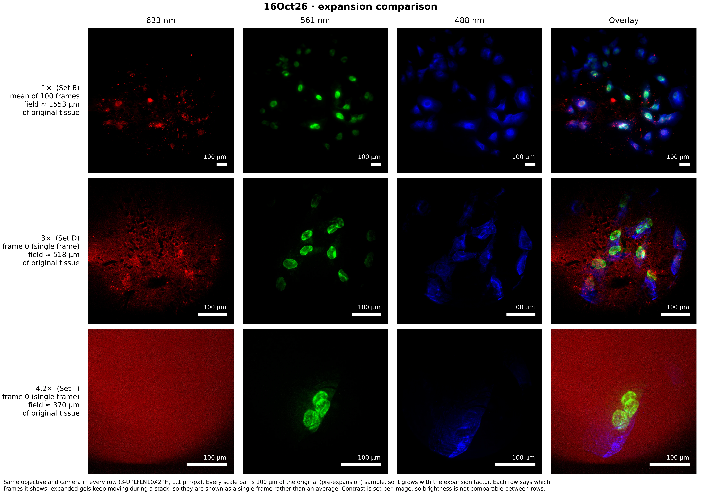
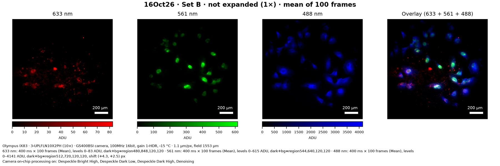
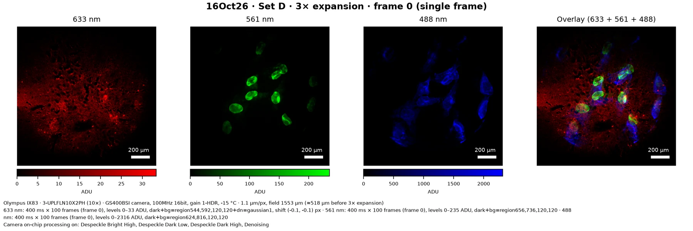
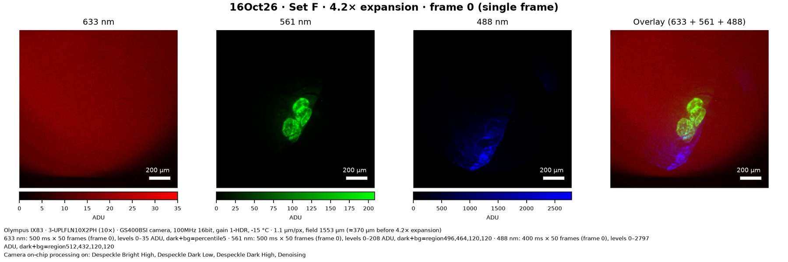
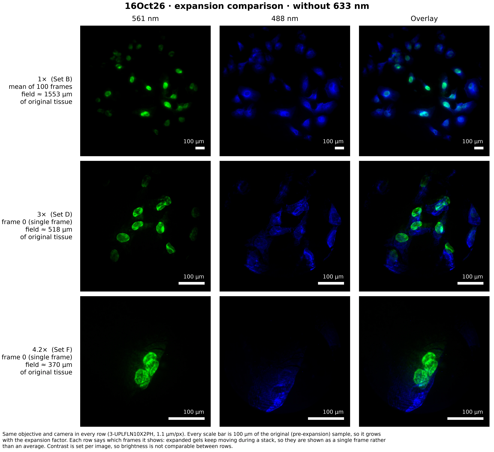
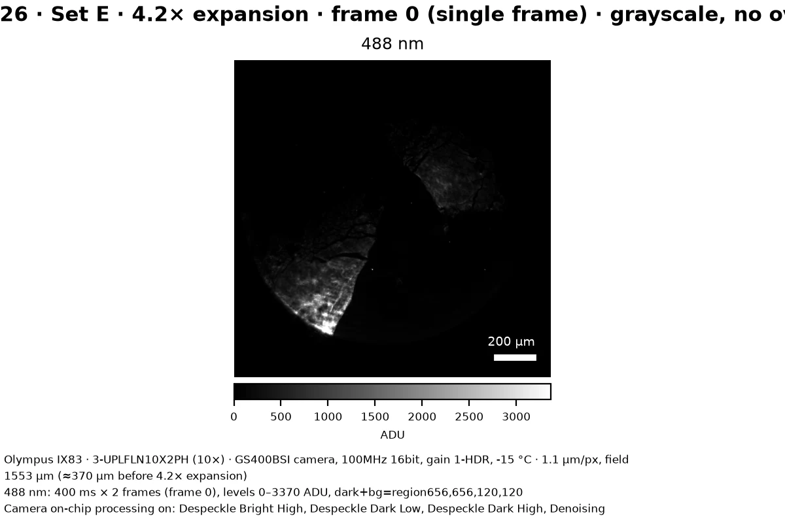
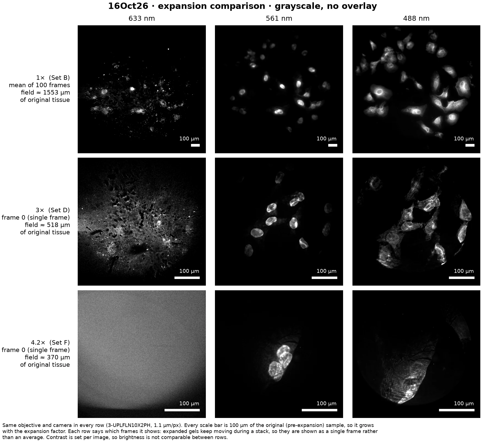
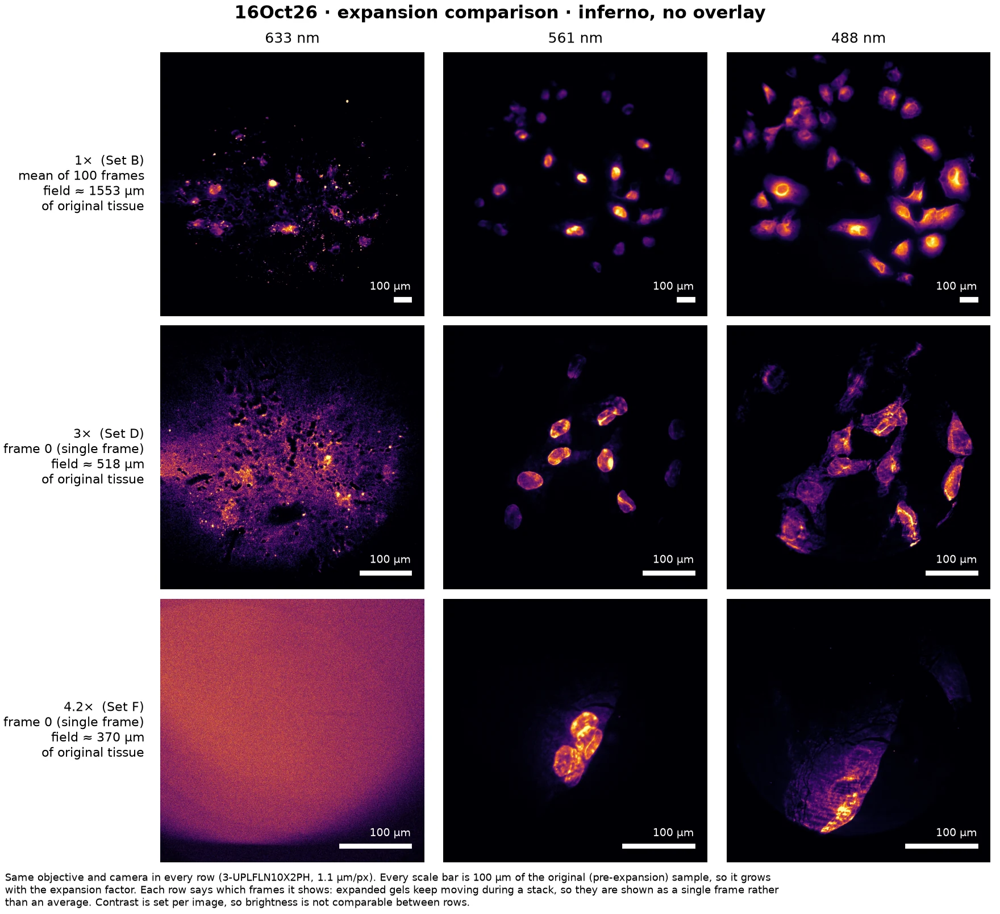
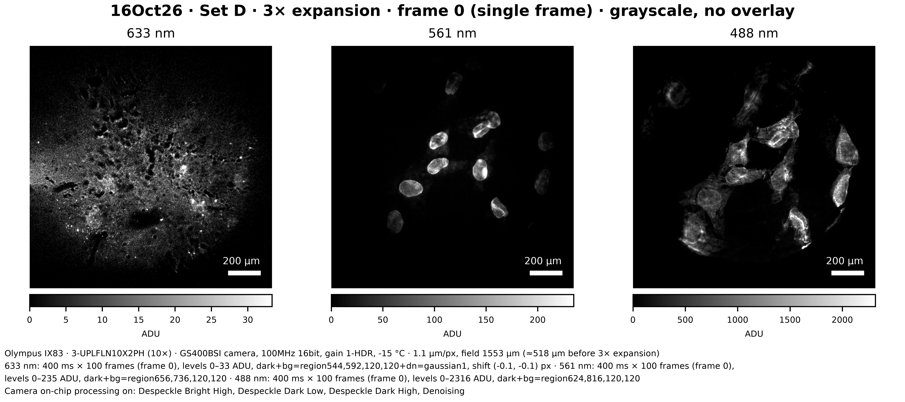
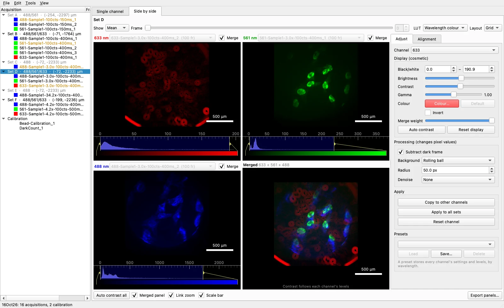

# Learning the IX83: first three-colour images at 1×, 3.0× and 4.2× expansion

*2026-11-03*

On 16 October I had my first session on the lab's Olympus IX83. I imaged one sample (`Sample1`) in three colours (488, 561 and 633 nm excitation): first unexpanded, then the same gel and cells again as it expanded to 3.0× and 4.2×. I also took a dark-count stack and a bead stack. That gave 18 acquisitions in about two and a half hours.

Micro-Manager saves each acquisition as a stack of 16-bit frames with a metadata file. That's not easy to browse, so I built a small desktop viewer, the **IX83 Analysis Pipeline**, to look at the images properly. It shows each laser line in its own colour, overlays the channels, lines them up, adjusts the contrast and exports figures. This post covers how the microscope was set up, what the first images look like at each expansion factor, and the things I learned about the microscope along the way. Most of those are things to change before the next session.

This is a learning log, not an analysis. The images were taken to learn the microscope and to test the viewer. None of the numbers below are results about the sample.

*Click any image to open it at full camera resolution (every one of the 1412 × 1412 pixels).*

*The same objective and camera in every row; only the expansion factor changes. The 1× row is the mean of 100 frames; the 3.0× and 4.2× rows are a single frame each (frame 0), because expanded gels keep moving while a stack is recorded (see below). Every scale bar is 100 µm of the original, pre-expansion sample, so the bar grows from about 90 px at 1× to about 380 px at 4.2×. The field of view always covers 1553 µm of gel, which is about 518 µm of original sample at 3.0× and about 370 µm at 4.2×. Contrast is set separately for each image, so brightness can't be compared between rows. Colours: 633 nm red, 561 nm green, 488 nm blue.*

## How the microscope was set up

All of this comes from the Micro-Manager metadata saved with each image, except where marked.

| | |
|---|---|
| Microscope | Olympus IX83 (inverted), camera on the left port |
| Objective | UPLFLN 10X2PH: 10×, phase-contrast UPlan FLN (turret position 3) |
| Camera | Teledyne Photometrics, chip GS400BSI, 1412 × 1412 pixels, 16-bit. A 1412-pixel GSENSE400BSI chip is the Prime 95B, with 11 µm pixels (*my inference; the model isn't recorded*) |
| Camera mode | 100 MHz 16-bit readout, gain "HDR", sensor at −15 °C, offset 100 ADU, binning 1×1 |
| Pixel size at the sample | **1.1 µm** (11 µm ÷ 10×). The field of view is 1553 µm. *The metadata says 0.102 µm; see below.* |
| Excitation | 488, 561 and 633 nm, one per acquisition. *The wavelength is only in the folder name.* |
| Acquisition | Micro-Manager 2.0.3, a time series of 100 frames per acquisition ("100cts" in the name) at 150, 400 or 500 ms per frame, so 48 s per stack at 400 ms |
| Calibration stacks | `DarkCount_1` (1000 frames, 10 ms) and `Bead-Calibration_1` (100 frames, 10 ms), both taken with the 100× oil objective UPLSAPO100XO |

### What was imaged

The viewer groups acquisitions by stage position, so channels taken at the same place become one "set". These are the sets:

| Set | Expansion | Channels | Exposure | Notes |
|---|---|---|---|---|
| A | 1× | 488, 561 | 150 ms | one 488 stack stopped at 84 of 100 frames |
| **B** | **1×** | 488, 561, 633 | 400 ms | three 561 repeats; the focus differs by 12.6 µm between channels |
| C | 3.0× | 488 | 400 ms | stopped at 12 of 100 frames |
| **D** | **3.0×** | 488, 561, 633 | 400 ms | |
| E | 4.2× | 488 | 400 ms | 2 frames; the folder says "34.2x", a typo for 4.2x. The gel has fractured (see below). |
| **F** | **4.2×** | 488, 561, 633 | 400 / 500 / 500 ms | 50 frames each |

Sets B, D and F have all three colours, so they're the ones shown here.

*Set B (1×). Each channel is the mean of 100 frames, with the dark frame and a constant background subtracted. The background is the median of a 120 × 120 px box placed on an empty area near the centre of each image. Each panel has its own intensity scale in camera counts (ADU). The right-hand panel overlays all three channels, using the channel offsets saved in the viewer. The caption under the figure is generated from the metadata.*

*Set D (3.0×): frame 0 of each stack, dark-subtracted.*

*Set F (4.2×): frame 0 of each stack, dark-subtracted. At this expansion the 10× field holds only a few cells, so the next step for expanded samples is a higher-magnification objective.*

## Why the expanded images are single frames

At 1×, the 100 frames of a stack are essentially the same image, so averaging them is a free way to cut noise. Expanded gels are different: they keep moving and changing shape during the 40–50 s of a stack.

| Acquisition | Frames | Shift, first to last frame (px) | Similarity of first and last frame (r) |
|---|---|---|---|
| 488, 1× | 100 | (+0.4, +0.7) | 0.98 |
| 561, 1× | 100 | (+0.8, +0.6) | 0.99 |
| 488, 3.0× | 100 | (−21.5, +20.3) | 0.18 |
| 561, 3.0× | 100 | (+0.6, +16.2) | 0.42 |
| 488, 4.2× | 50 | (+14.4, +29.5) | 0.37 |
| 561, 4.2× | 50 | (+4.5, +22.6) | 0.14 |

*Shift from phase correlation of the fine structure in the central 1012 × 1012 px. r is the correlation of that fine structure between the first and last frames: 1 means identical.*

An expanded gel drifts 16–33 px (about 18–36 µm) during one stack, and the image itself changes, not just its position. Averaging those frames smears the cells, so every expanded panel here shows **one frame (frame 0), with the dark frame subtracted**. Frame 0 is the earliest moment of the expansion, and for 488 the least bleached. The overlays of expanded sets use channel offsets measured on the averaged images. Each channel is its own stack recorded at a different moment, so the overlays at 3.0× and 4.2× are approximate.

## The same comparison without the 633 channel

*The same three sets as the first figure, with only 561 (green) and 488 (blue). Without 633 the overlay is much easier to read.*

The 633 channel is the noisiest of the three, and it gets worse with expansion. The likely cause is **photobleaching**: by the time each 633 stack was recorded, the dye had already been exposed for a long time, so little signal was left. Imaging needs to be quicker, with less light on the sample before the stack starts.

| Set | Channel | Background (ADU) | Signal above background (ADU) | Single-frame SNR | Signal lost within the stack |
|---|---|---|---|---|---|
| B (1×) | 633 | 256 | 72 | 3.9 | 1.7% |
| D (3.0×) | 633 | 231 | 35 | 2.0 | 1.3% |
| F (4.2×) | 633 | 19 | 3 | 0.6 | −0.6% |
| B (1×) | 488 | 415 | 3278 | 73 | 24% |
| D (3.0×) | 488 | 176 | 1279 | 42 | 27% |

*Measured in the centre half of each field, after dark subtraction. "Signal" is the bright end (99th percentile) of the smoothed mean image minus its background (10th percentile). "Single-frame SNR" is that signal divided by the frame-to-frame noise of one pixel.*

The 633 signal is tiny: 72 ADU at best on about 250 ADU of background, so a single frame has an SNR of about 4 at 1×, 2 at 3.0×, and below 1 at 4.2×. During its own 48 s stack 633 loses only 1–2%, so the bleaching must have happened earlier: in the time spent finding, focusing and setting up each field before recording. 488 shows bleaching happening live, losing about a quarter of its signal within each stack. Either way the lesson is the same: image faster and keep the light off the sample until the stack starts. The 4.2× gel also spreads each label over about 74× the volume, which leaves even less signal to bleach.

Some of what the 633 images show isn't the sample. The fine structure in the 633 image at 1× (Set B) and at 3.0× (Set D) is correlated (r = 0.43), even though those are different stage positions. 561 and 488 taken at the same two places don't correlate at all (r = 0.01 and −0.02). A pattern that stays put while the sample moves must be in the microscope, most likely dirt on an optic in the 633 light path. With so little signal left after bleaching, that pattern stands out.

## Set E: the gel fractured at 4.2×

*Set E, 488 nm only, frame 0, dark-subtracted, in grayscale. It was taken at 4.2× (one minute before Set F, at the same focus). Fine dark cracks branch through the fluorescent regions, and a wide dark band runs across the field where the gel has separated.*

Set E is a single 488 image at 4.2×, but it's the clearest picture of something that went wrong in the sample. The labelled material is torn apart: branching cracks run through it, and a wedge of empty gel cuts across the middle. Grayscale shows this better than the blue colour map, because the eye picks out structure in gray far better than in dark blue.

A likely cause is **incomplete homogenisation**. If the digestion step doesn't fully break down the cells' mechanical structure, the cells resist the gel's expansion instead of expanding with it, and at 4.2× they tear. That's a guess from one image, not a diagnosis. But it's worth checking the digestion time and conditions before the next expanded sample, because tearing like this would also distort the ArUco markers the project depends on.

## Every channel on its own, in grayscale and inferno

*Each channel of Sets B, D and F in grayscale, without the overlay. The 633 column shows the same fixed pattern at 1× and 3.0× (compare the dark spots), and almost nothing at 4.2×.*

*The same images with the inferno colour map, which runs from black through purple and orange to yellow. Equal steps in brightness look like equal steps in colour, so dim structure is easier to judge than in a single-hue map.*

Colour overlays make it easy to see which channels coincide, but they hide detail, especially in dim blue. Shown separately in grayscale, each channel's own structure is easier to judge: the nuclear-looking shapes in 561, the more spread-out cell bodies in 488, and the fixed optical pattern in 633. The viewer now exports this version for every set.

*Set D (3.0×) as three separate grayscale channels.*

## The viewer

*Set D in the viewer's Side by side view: one panel per laser line, each with its own contrast, plus the overlay. The Adjust panel on the right is set to subtract the dark frame, and the rolling-ball background removal is on for 633.*

The viewer is a PySide6 app built in six steps:

1. **Reading the data:** it reads Micro-Manager stacks one frame at a time, so a 400 MB stack opens instantly. It groups acquisitions by stage position and flags anything odd.
2. **Single channel:** a single-channel view coloured by laser line, with a frame slider or frame averaging (mean, max, median), a histogram with an intensity scale in ADU, and a scale bar.
3. **Side by side:** every laser line of a set in its own panel, with pan and zoom linked between panels, plus an overlay.
4. **Alignment:** an automatic channel alignment that only applies results it's confident in, arrow-key nudging, and blink and difference views for checking by eye.
5. **Adjustments:** brightness, contrast, gamma and colour, dark-frame subtraction, background subtraction and denoising, with undo and presets.
6. **Export:** raw 16-bit TIFFs (the processed values, never contrast-stretched), Fiji-ready multi-channel stacks, figures, movies, and **Export panels**, which produced the figures in this post. It makes colour, without-633 and grayscale versions of every set, and an inferno-coloured image of every channel. Every export writes a `.json` file recording exactly which settings were used.

It also has a line-profile tool, region statistics, a photobleaching curve and colocalisation, plus a **Data check** report that collects everything suspicious about a day's data.

## What I learned about the microscope

These are the useful part of the session: things to fix before taking data that matters.

1. **The laser line isn't saved with the image.** Micro-Manager had no channel configuration set up, so every acquisition is a single channel called "Default". The wavelength exists only in the folder name I typed. One folder (`633-…3.0x…_2`) contains files named `561-…` from an earlier name. Its brightness matches the other 633 stacks, so it is almost certainly 633 data, but nothing in the file proves it. **Fix:** set up a Micro-Manager channel group (laser line, power, filter) so it is recorded with every frame.
2. **The pixel size in the metadata is wrong for the 10× objective.** Micro-Manager stores 0.102 µm, which matches the 100× objective, not the 10× used for every sample image. The viewer uses 11 µm ÷ 10 = 1.1 µm/px. But if 0.102 µm was measured, the true magnification may be about 8% above nominal, which would make the 10× pixel about 1.02 µm. **Fix:** set one pixel-size calibration per objective in Micro-Manager, and measure the 10× one with a stage micrometer.
3. **The camera's built-in processing was on.** The camera's despeckle (bright and dark) and denoising filters were enabled. They change pixel values before Micro-Manager sees them, which is fine for pictures but not for anything quantitative (intensities, signal-to-noise, bead fitting). **Fix:** turn them off in the camera settings for measurements.
4. **The camera has an offset of about 100 counts.** The dark stack has a median of 99 ADU, matching the camera's 100 ADU offset setting. Subtracting a master dark frame (median of the 1000 dark frames) removes it, which matters most for the dim 633 channel.
5. **The channels are slightly misaligned, and auto-alignment only partly worked.** In Set B the 488 image sits about (+4.4, +2.6) px from 561: 5 px, or about 5.5 µm at 1.1 µm/px. Automatic alignment between channels was unreliable on this sample, because each colour shows different structures. Every image also contains patterns that don't move with the sample (fixed camera pixels, the edge of the illuminated field, debris in the light path), and these pull the estimate towards "no shift". The viewer only applies confident results. **Fix:** image multi-colour fluorescent beads in all three channels with each objective, and save the measured offsets as a calibration. The bead stack from this session has no wavelength in its name, so it can't be used for that.
6. **633 is noisy, most likely from photobleaching.** The 633 images have very little signal left (single-frame SNR 0.6–4), most likely because the dye was bleached before each stack was recorded. Some of what remains is a fixed pattern from dirt in the 633 light path (see above). Background subtraction helps the look. The real fixes are imaging faster with less light on the sample beforehand, and cleaning the 633 path. The edge of the illuminated field is visible in the corners of most images, which matters for flat-field correction later.
7. **488 bleaches.** Over a 100-frame, 48 s stack at 400 ms per frame, 488 lost 24–27% of its signal (Sets B and D), while 561 and 633 changed by less than 2%. For 488, image faster or use a short average of the first frames.
8. **Expanded gels are still moving while they're imaged.** At 3.0× and 4.2× the field drifts 16–33 px during a 40–50 s stack, and the image changes shape (see the table above). **Fix:** let the gel settle before imaging, keep expanded stacks short, and use single frames rather than averages until it does.
9. **Where the background box goes matters.** For most channels I subtracted a constant background: the median of a 120 × 120 px box. At first I left that box where the viewer puts it, at the centre of the image. At 1× it happened to fall in a gap between cells, but at 3.0× and 4.2× it sat on cells: on a nucleus in the 4.2× 561 image, where it read 134 ADU against a true background of about 28. That subtracted real signal and cut dim structure to black. For the figures here, each box was moved to the flattest cell-free area near the centre of its image. The centre is also the brightest part of the illuminated field, so any single constant over-subtracts towards the edges; a flat-field correction would deal with that properly.
10. **Some housekeeping:** three stacks stopped early (84, 12 and 24 frames), one name has a typo ("34.2x"), and the focus moved by up to 12.6 µm between channels of the same set. None of this is serious, but all of it makes the data harder to trust a month later. The Data check report now catches all of it automatically.

## Next

- Configure Micro-Manager properly: channel presets (laser line, power, filter), a pixel calibration for each objective, and the camera's built-in processing switched off.
- Image multi-colour beads in all three channels with the 10× and 100× objectives, to measure the channel offsets once.
- Measure the 10× pixel size with a stage micrometer.
- Image expanded samples with a higher-magnification objective, so the 4.2× field holds more than a few cells.
- Check the homogenisation (digestion) step for the 4.2× samples, given the fracturing in Set E.
- Let expanded gels settle (and check by eye that the drift has stopped) before recording a stack.
- Image faster, and keep the lasers off the sample while finding and focusing a field, so the dyes (633 most of all) aren't bleached before the stack starts.
- Clean the optics in the 633 light path, and image a blank area in 633 to confirm the pattern is gone.
- Then image the printed ArUco markers on the IX83. That's the reason for learning the microscope in the first place.
