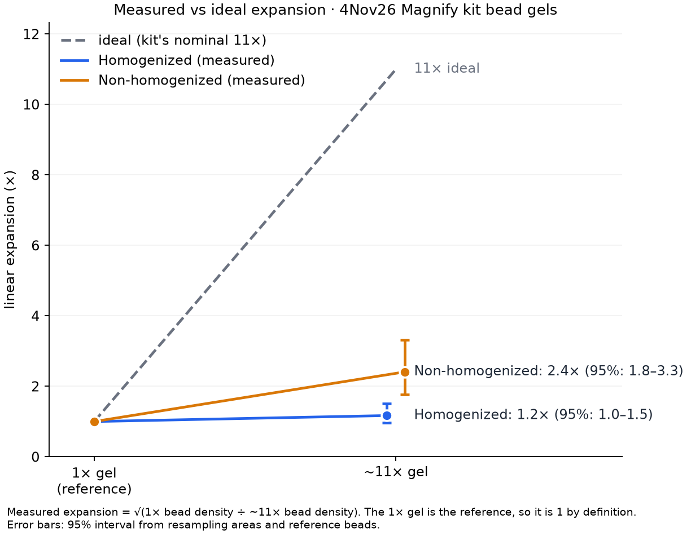
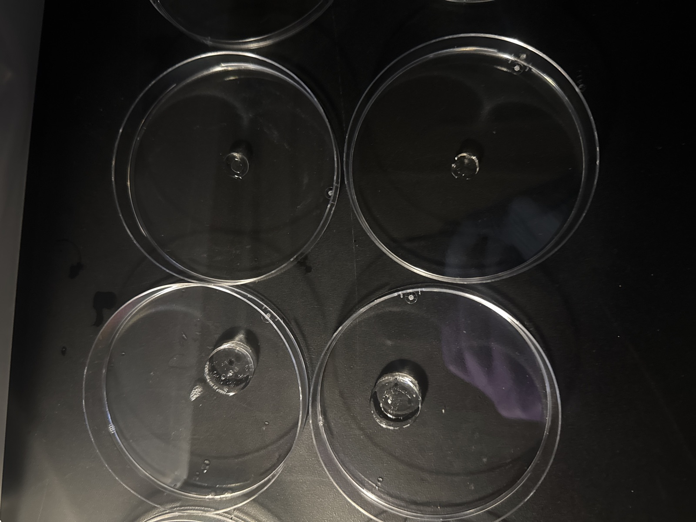
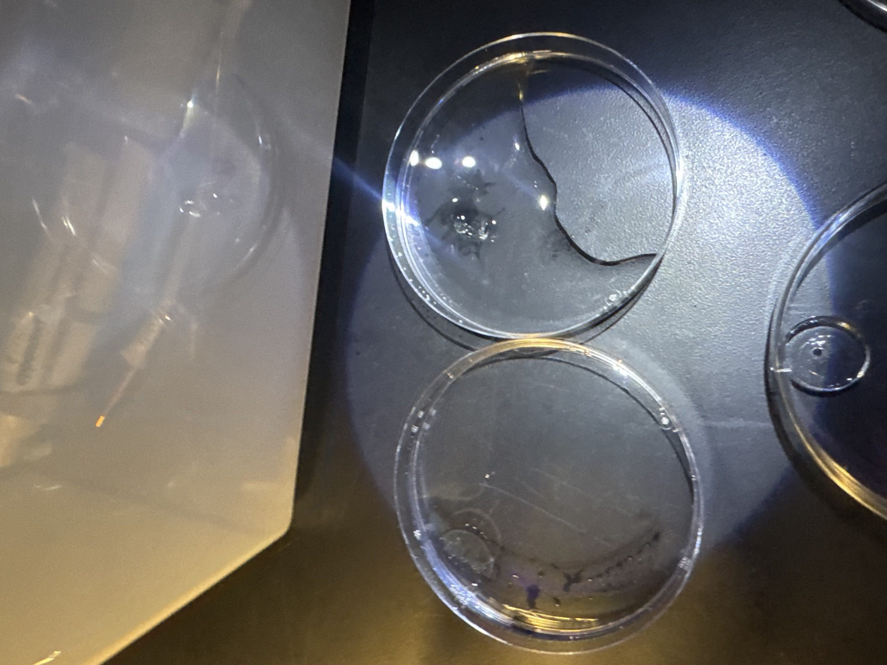
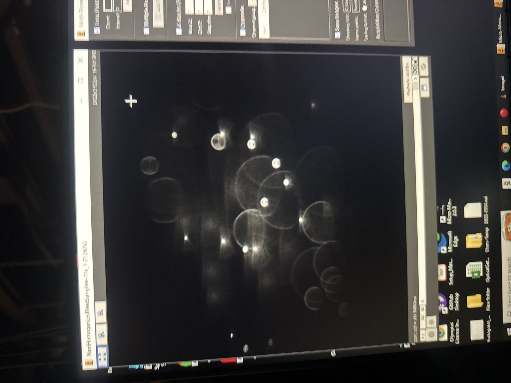
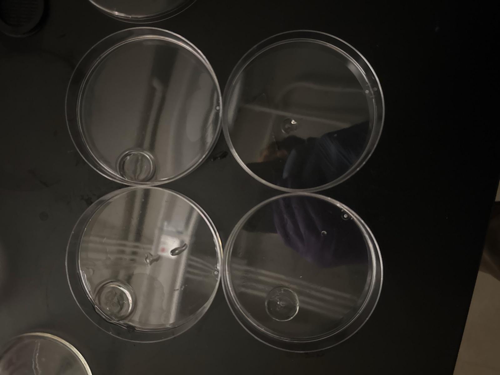
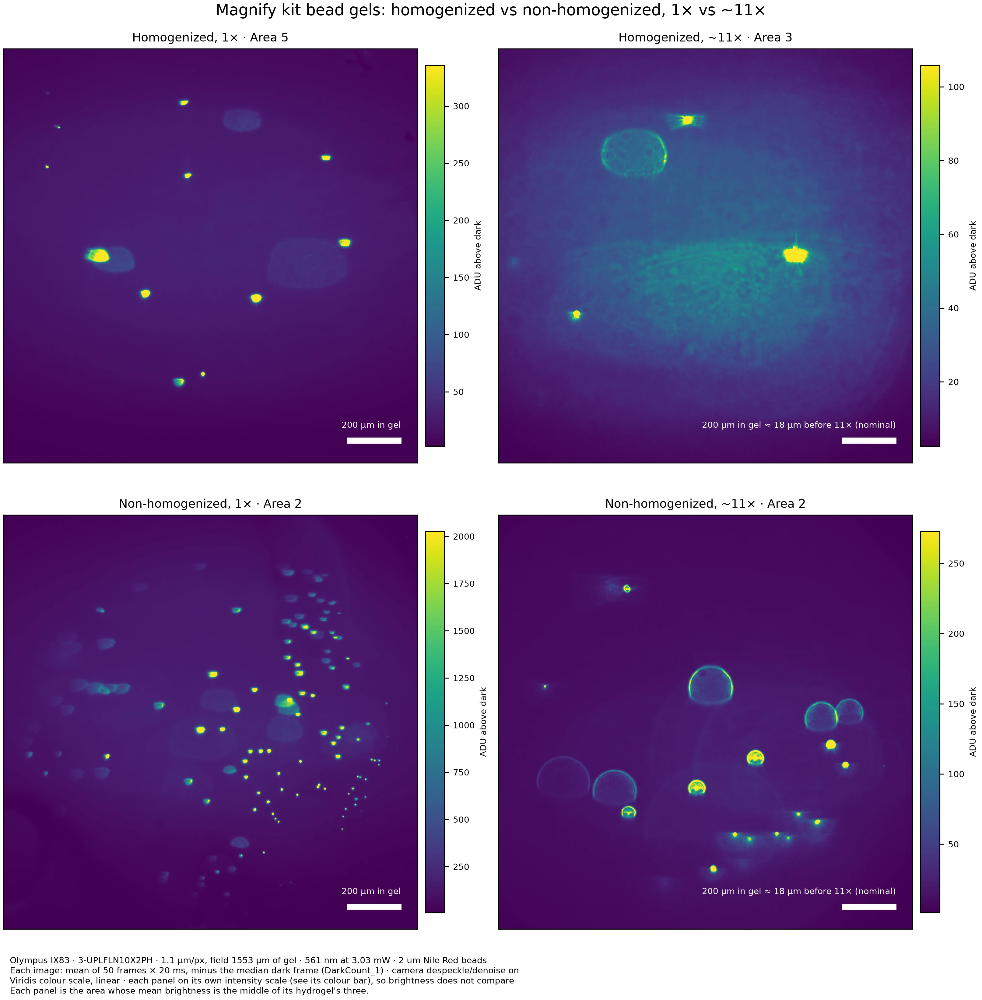
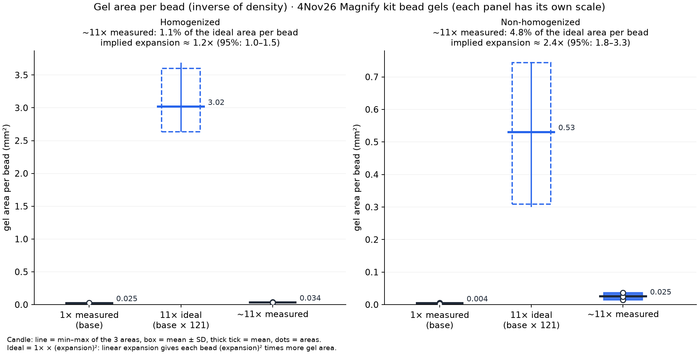
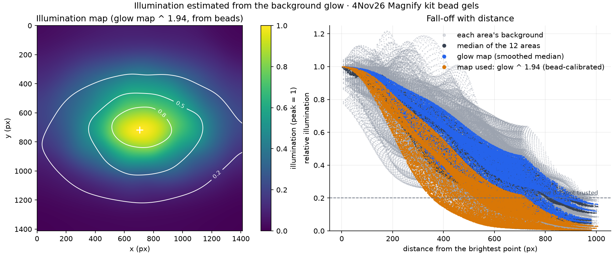
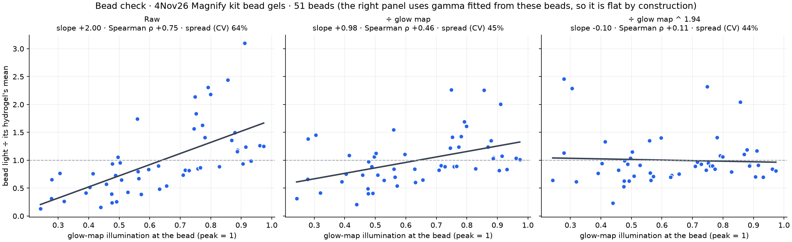

# Testing the Magnify kit with bead gels: the "11×" gels expanded about 1.2–2.4×

*2026-11-09*

On 4 November I prepared four hydrogels from the Magnify cell culture expansion kit. The gels held 2 µm Nile Red fluorescent beads instead of cells. Two gels went through the kit's homogenization step and two didn't. One gel of each kind stayed unexpanded (1×), and the other was expanded towards the kit's nominal 11×. I imaged three random areas of each gel on the IX83 with the 561 nm laser, then estimated how far each gel actually expanded from how thinly its beads were spread.

The short answer: **neither "11×" gel came close to 11×.** From the drop in bead density, the homogenized gel expanded about **1.2×** and the non-homogenized gel about **2.4×**. The most likely reason is in the protocol: I expanded the gels in 1× PBS, but the kit sheet only promises 4× in PBS. 11× needs washes in de-ionised water.

This is a rough analysis, built to check whether the expansion happened at all. It isn't a precise measurement of the expansion factor. The raw lab notebook (voice notes, transcripts and photos) is in [`lab-notebook/2026-11-04-magnify-kit-preparation-and-imaging/`](../lab-notebook/2026-11-04-magnify-kit-preparation-and-imaging/).

*Main result. Linear expansion of each "~11×" gel compared with its own 1× gel (1 by definition), against the kit's nominal 11× (dashed). Measured expansion is the square root of the drop in bead density (see below). Error bars are 95% intervals from resampling the imaged areas and the reference beads.*

## The experiment

**Samples.** Four Magnify bead gels, all with 2 µm Nile Red beads:

| | Homogenized | Not homogenized |
|---|---|---|
| **1×** (no PBS) | H 1× | NH 1× |
| **~11×** (in 1× PBS) | H ~11× | NH ~11× |

**Homogenization** (two gels): 45 minutes in 3 mL of buffer H at about 95 °C, then five 15-minute washes in 5 mL of 1× buffer W on the orbital shaker at 70 rpm. The 1× buffer W was 5 mL of buffer W in 45 mL of water. I skipped the immunostaining and post-staining washes, which would have added 2–3 hours: beads don't need staining.

**Expansion.** The plan was to image one gel of each type at 1× and again after a 4× expansion, and the other at 11×. In the end only 1× and "~11×" were imaged. The ~11× gels were submerged in about 10 mL of 1× PBS for three 15-minute periods, flipped with a spatula every 5 minutes, and then given a fresh 1× PBS bath for another 15 minutes. I submerged them fully instead of using the orbital shaker. In total they spent about an hour and a half in PBS before they were imaged.

**Imaging.**

| | |
|---|---|
| Microscope | Olympus IX83, UPLFLN 10× objective (from the image metadata) |
| Camera | Prime 95B, 1.1 µm per pixel at 10×, so the field is 1553 µm of gel |
| Laser | 561 nm at **3.03 mW** (ND1). Measured: 33.6 mW at ND0, 3.03 mW at ND1, 284.5 µW at ND2 |
| Each image | 50 frames at 20 ms, three random areas per gel |
| Calibration | Dark count (1000 frames at 10 ms); two laser-calibration bead stacks, not used here |

## Timeline (4 November)

| Time | What happened |
|---|---|
| 2:45 PM | Took the gels out of the six-well plate and checked two by removing the silicone ring |
| 2:47 PM | Two gels into buffer H (3 mL each, 15 mL tubes), into the incubator for 45 min at about 95 °C |
| 2:48–3:09 PM | Five washes in 1× buffer W, 15 min each at 70 rpm |
| 3:13 PM | Skipped immunostaining and post-staining (bead samples) |
| 3:30 PM | Decided to submerge the gels fully in about 10 mL of 1× PBS instead of using the orbital shaker |
| 3:45 PM | In the optics lab: four petri dishes, one per gel |
| 3:49 PM | **The homogenized gels were 2–3× larger than the non-homogenized ones, before any PBS** |
| 3:51 PM | One homogenized and one non-homogenized gel into 10 mL of 1× PBS for the ~11× expansion (3 × 15 min, flipped every 5 min) |
| 4:01 PM | Started up the IX83: camera, the two modules in order, the controller, then the computer |
| 4:15 PM | Took the dark count (1000 frames) |
| 4:23–4:30 PM | Turned on the 561 laser and measured its power at ND0, ND1 and ND2 |
| 4:32 PM | Advice: keep ND1 and the same power for every measurement, so results can be reproduced. Set ND1 for the rest of the session |
| 4:37 PM | **The ~11× gels had barely expanded, if at all, compared with the gels that weren't in PBS** |
| 4:44 PM | Moved the ~11× gels into fresh 1× PBS in beakers for another 15 min |
| 5:03–5:06 PM | Laser-calibration bead stacks; the notebook records "horizontal 2.60379, vertical 2.55124" for the bead sample |
| 5:15–5:26 PM | Imaged the homogenized and non-homogenized 1× gels, three areas each |
| 5:31–5:38 PM | Imaged the homogenized and non-homogenized ~11× gels, three areas each |
| 5:41 PM | Finished imaging. Put one homogenized gel in water to see whether it changes size |
| 5:55 PM | Photographed all four gels |
| 6:12 PM | Cleaned up, turned off the microscope, moved everything back to the wet lab |

## What the notebook recorded

*3:49 PM, before any PBS. The notebook records that the two homogenized gels were 2–3× larger than the two non-homogenized gels: those are the two larger gels on the left. Homogenization itself made them swell.*

*3:57 PM. The two ~11× gels in 1× PBS. By 4:37 PM they hadn't visibly grown.*

During imaging I noted that the homogenized ~11× gel had very sparse beads. The non-homogenized ~11× gel was denser, but not as dense as the non-homogenized 1× gel.

*5:37 PM, a phone photo of the screen during acquisition of the non-homogenized ~11× gel. The rings and discs are beads that are out of focus: the gel is thicker than the depth of focus, so beads at different heights blur by different amounts. Only a few are sharp.*

*5:55 PM, all four gels. Top left: homogenized ~11×, also put in water at the end. Top right: non-homogenized ~11×. Bottom left: homogenized 1×. Bottom right: non-homogenized 1×.*

## The images

*One area of each gel: the area whose mean brightness is the middle of that gel's three, so none were hand-picked. Each image is the mean of 50 frames minus the dark frame, in the viridis colour scale. Each panel has its own intensity scale (see its colour bar), so brightness can't be compared between panels. Scale bars are 200 µm in the gel. On the ~11× panels, at a nominal 11× that would be about 18 µm of the original gel. [Every area of every gel](images/2026-11-09-magnify-all-areas.webp) is also available.*

Sharp beads appear as small bright spots. Out-of-focus beads appear as large discs and rings, which are the shape of the objective's aperture. The non-homogenized 1× gel has far more beads than the others.

## Measuring how far each gel expanded

The gels weren't measured with a ruler after expansion, so the expansion has to come from the images. If a gel expands by a factor *E* in every direction, the same beads spread over *E*² times the area. Looking down through the whole gel, the number of beads per mm² falls by *E*². Magnify's 11× is a linear expansion: the [Magnify paper](https://www.nature.com/articles/s41587-022-01546-1) reports up to 11× linear, about 1,300× by volume. So an ideal 11× gel should have **121 times fewer beads per mm²** than its 1× gel.

Counting beads directly doesn't work here, because most beads are out of focus. But a blurred bead still puts the same amount of light on the camera as a sharp one, just spread out. So for each area:

1. Correct the image for uneven illumination (see below), and keep only the well-lit middle of the field (1.13 mm² of gel, the same region in every image).
2. Subtract the gel's own dim background glow.
3. Add up all the light, and divide by the light of a single bead. That gives the number of beads in view.
4. Divide by the area to get beads per mm².

The light of a single bead came from 52 single, in-focus beads that I circled by hand, spread across all four gels. Comparing each ~11× gel with its own 1× gel gives the density drop. The square root of that drop is the linear expansion.

### Main result 2: gel area per bead

*Gel area per bead (the inverse of density) for each gel's 1× areas, the ideal 11× (1× × 121), and the measured ~11× areas. Candle: line = min–max of the three areas, box = mean ± SD, thick tick = mean, dots = the areas.*

| | 1× (beads/mm²) | Ideal 11× (1× ÷ 121) | ~11× measured | Density drop (ideal 121) | Implied expansion (95% interval) |
|---|---|---|---|---|---|
| Homogenized | 41 ± 7 | 0.34 | 30 ± 3 | 1.4 (0.9–2.3) | **1.2×** (1.0–1.5) |
| Non-homogenized | 262 ± 126 | 2.2 | 45 ± 21 | 5.8 (3.1–11) | **2.4×** (1.8–3.3) |

*± is the standard deviation across the three areas of each gel.*

In area per bead: the homogenized ~11× gel has 1.1% of the area per bead an 11× gel should have, and the non-homogenized one 4.8%.

## Why the gels didn't reach 11×

**Probably the expansion medium.** On the kit's protocol sheet, filling the plate with 1× PBS gives a **4×** expansion. **11×** comes from at least three 15-minute washes in fresh **de-ionised water**. I used PBS for both. So the most these gels could have reached was about 4×, and in about an hour and a half they reached less than that. The notebook saw the same thing at 4:37 PM: the "11×" gels looked no bigger than the unexpanded ones.

**The homogenized gels had already expanded before the PBS.** At 3:49 PM they were 2–3× larger than the non-homogenized gels. The bead densities agree: the homogenized 1× gel has 6.4× fewer beads per mm² than the non-homogenized 1× gel, which works out to a linear swelling of about 2.5×. (That comparison assumes both gels started with the same number of beads.) Measured against the unexpanded, non-homogenized gel, every gel that saw buffer or PBS ended up about 2.4–3× larger:

| Gel | Linear size compared with non-homogenized 1× |
|---|---|
| Homogenized 1× | about 2.5× |
| Homogenized ~11× | about 3.0× |
| Non-homogenized ~11× | about 2.4× |

So the homogenized "1×" reference wasn't really unexpanded, which is part of why the homogenized gel's own expansion looks so small (1.2×).

## Correcting for uneven illumination

The 10× field isn't evenly lit: the corners get only about a tenth of the light the centre does. The same bead therefore looks 5–10× dimmer near a corner. Both the total light and the single-bead light depend on this, so it has to be corrected.

**Step 1: a map from the background glow.** For each of the 12 areas, the beads and blur discs were removed with a rolling low percentile (the 20th percentile in a 124 px window), leaving the background glow of the gel and the out-of-focus haze. All of it is lit by the same light, so the median across the 12 areas gives the shape of the illumination. It's smoothed and scaled so the brightest point is 1. That point is close to the centre of the image, at (706, 718) px.

*Left: the illumination map used. Right: the fall-off with distance from the brightest point. Grey dots are each area's background, dark dots their median, blue the smoothed glow map, and orange the map actually used (step 2). Below 0.2 of the centre's light the correction isn't trusted.*

**Step 2: checking the map against beads.** A good map should make every bead equally bright once corrected, wherever it is in the field.

*Each dot is one reference bead's light divided by its gel's average. Left: raw. Middle: divided by the glow map. Right: divided by the glow map raised to the power 1.94.*

The glow map on its own only did half the job. Raw bead light rose steeply with illumination (Spearman ρ = 0.75), and dividing by the glow map still left a clear trend (ρ = 0.46). The glow falls off more gently than the light that reaches an in-focus bead. A likely reason is that the glow is mostly out-of-focus light, which spreads sideways and flattens the fall-off. Trying other map shapes (a polynomial fit, a smooth elliptical spot, the unsmoothed median) didn't change this.

So the map keeps the shape of the glow but is made steeper, by an amount fitted from the beads: bead light ∝ glow^γ, with a separate brightness level for each gel. The fit gives **γ = 1.94 (95% interval 1.48–2.41, bootstrapped over the 51 beads used)**. After dividing by glow^1.94 the trend is gone (ρ = 0.11), and the spread between beads drops from 64% to 44%. The remaining spread is mostly real variation between beads. One caveat: γ is fitted from the same beads it's checked against, so the flat right-hand panel is flat by construction. It isn't an independent test. The interval on γ is the honest measure of how well the correction is known.

**Step 3: using only the well-lit middle.** With γ ≈ 2, only 47% of the field gets at least 20% of the centre's light. Outside that, the correction multiplies the signal by 5 or more, so any error in the map is amplified. Reference beads outside the 20% line were left out of the single-bead average, and total light was summed only inside it. Because that region is the same for the 1× and ~11× images, most of any remaining error cancels when the two are compared. Rerunning the analysis at both ends of the γ interval, or with one shared single-bead light for all gels, moves the implied expansion between 1.0× and 1.2× for the homogenized gel and between 2.1× and 2.9× for the non-homogenized gel. Neither comes anywhere near 11×.

The proper fix is a flat-field image: one picture of a uniform fluorescent slide at 561 nm with the same settings.

## Caveats

- **Same starting bead density.** Each ~11× gel is compared with a different 1× gel of the same type. That assumes the two started with the same density of beads.
- **Three areas per gel, from one gel each.** The error bars cover variation between areas, not between gels. The non-homogenized gels are patchy: their three 1× areas range from 163 to 403 beads/mm².
- **Background vs haze.** Subtracting the gel's background glow also removes any uniform haze from very blurred beads, and the two can't be told apart. Not subtracting it at all gives 1.0× and 2.5× instead.
- **Dense images read slightly low.** In a crowded field, blurred neighbours make reference beads look up to about 15% brighter, which slightly underestimates the dense non-homogenized 1× density.
- **Camera processing.** The camera's despeckle and denoising filters were on for every image (as on 16 October).
- **Objective.** One voice note says "20X", but the image metadata records the 10× objective, which is what the analysis uses. The pixel size wouldn't affect the expansion results (they're ratios), only the absolute densities.

## Next

- Repeat the ~11× expansion with de-ionised water, as the kit sheet says, and image the 4× (PBS) step as well.
- Measure every gel's size with a ruler or a camera photo next to a scale before and after expansion. That gives an independent check of the expansion factor.
- Image every gel in the same state before and after expansion, so each gel is its own reference and the "same starting density" assumption isn't needed.
- Take a flat-field image of a uniform fluorescent slide at 561 nm, and turn off the camera's built-in processing.
- See what happened to the homogenized gel left in water at the end.
