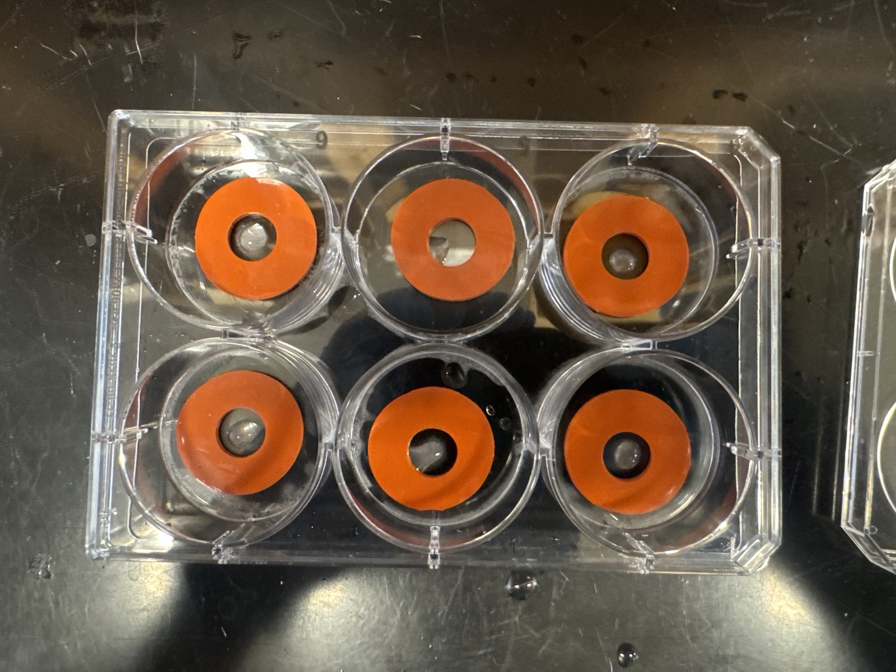
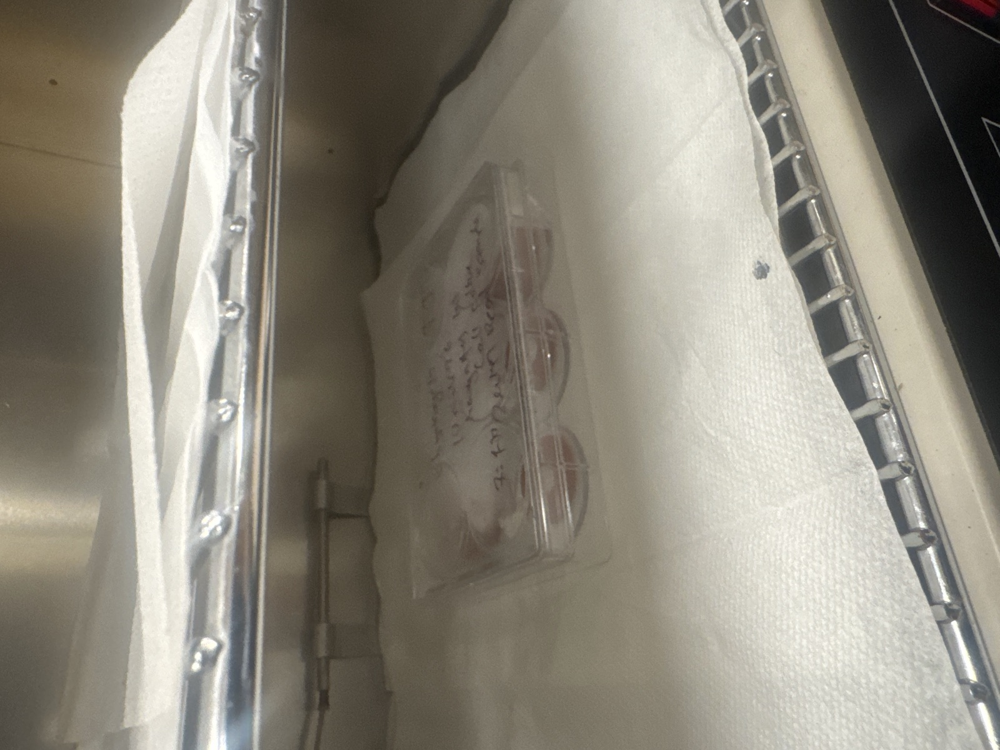
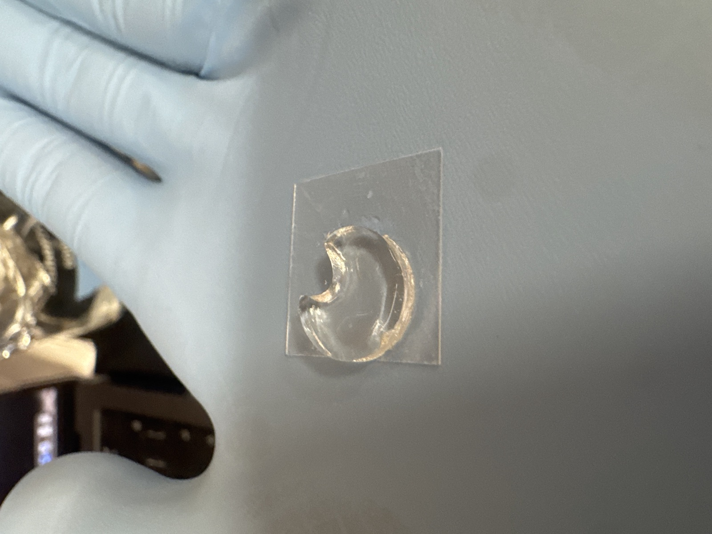
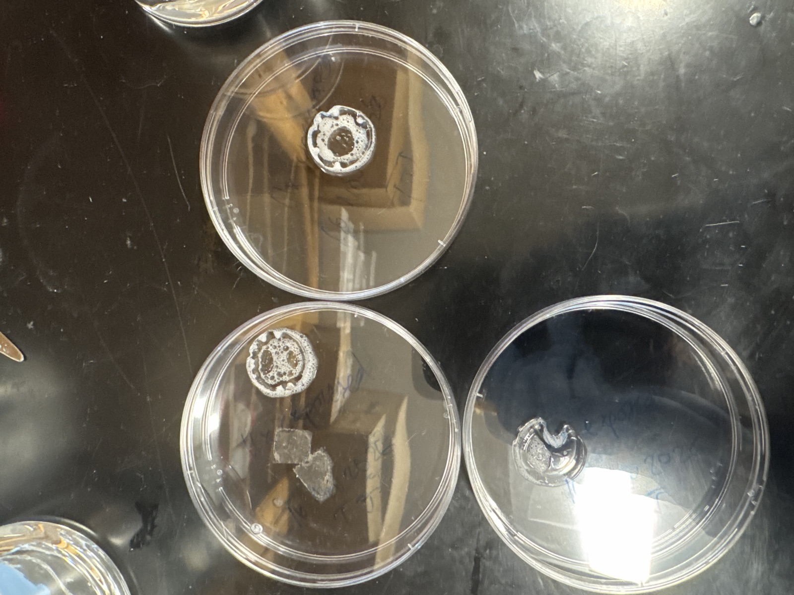
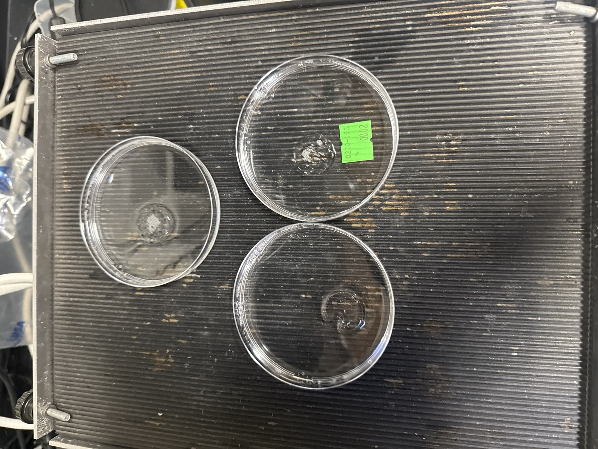
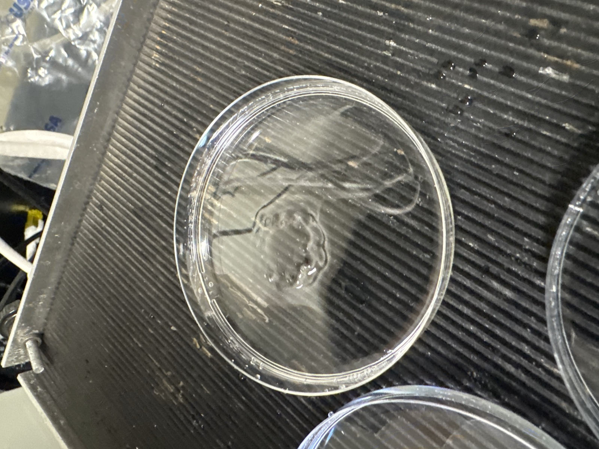
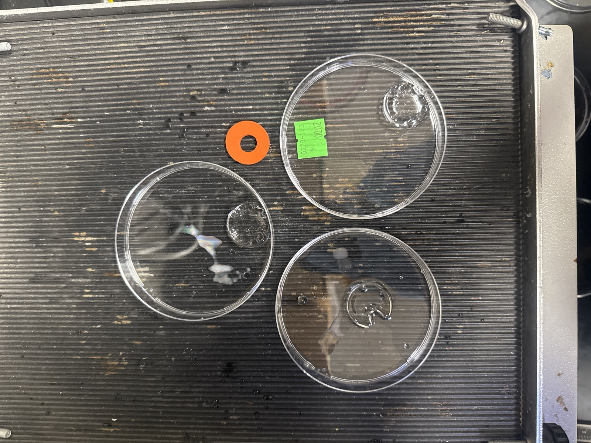

# Second Magnify bead-gel batch: a coverslip sandwich, and the gels still grew only about 1.2× in PBS and water

*2026-11-17*

After the [first batch](2026-11-09-magnify-kit-bead-gels.md) of Magnify bead gels expanded only about 1.2–2.4× instead of 11×, I made a second batch of six gels on 10 November. One thing changed: each gel was sandwiched between two coverslips instead of sitting on the bottom of the six-well plate, to seal it better from the air. On 16 November I homogenized three of them and expanded them in 1× PBS, then briefly in de-ionised water.

The short answer: **the gels still didn't come close to 11×.** Measured with a ruler, each gel grew only about **1.14–1.23×** in diameter between the end of homogenization and the end of expansion. Compared with the silicone ring they were cast in, I estimated about 3×. No gels were imaged this time.

These are ruler measurements of whole gels, taken by eye. They show whether the gels expanded at all, not a precise expansion factor. The raw lab notebooks (voice notes, transcripts and photos) are in [`lab-notebook/2026-11-10-magnify-gels-preparation/`](../lab-notebook/2026-11-10-magnify-gels-preparation/) and [`lab-notebook/2026-11-16-magnify-gels-homogenization-and-expansion/`](../lab-notebook/2026-11-16-magnify-gels-homogenization-and-expansion/).

## Day 1 (10 November): casting six gels

**What changed from the first batch.** Last time the silicone ring sat directly on the bottom of the well, so one face of the gel touched the plastic. I suspected the gel might be exposed to air. This time each well got a coverslip, the ring went on top of the coverslip, and a second coverslip went on top of the ring after the gelling solution was added.

**Method.**

| Step | Amount |
|---|---|
| Bead stock | 1:100 dilution of 2 µm Nile Red beads |
| Beads per ring | 20 µL, spread to cover the inside of the ring, then another 30 µL (50 µL in total) |
| Activation buffer | 600 µL of solution A into the kit's activation tube, vortexed about 2 min |
| Activated gelling solution | 25 µL of activation buffer into 500 µL of solution G in a 2 mL Eppendorf tube, mixed by pipetting. It must be used within 15 min |
| Gel volume | 250 µL per ring, so each tube made two gels. Three tubes made all six |
| Bead embedding | 15 min at 4 °C |
| Gelling | 37 °C in the incubator, a Kimwipe in each well. Planned 2 h, actually 1 h 45 min |
| Storage | 4 °C overnight, Kimwipes left in |

| Time | What happened |
|---|---|
| 2:17 PM | Goal: try again for 11× with six new gels |
| 2:52 PM | Coverslips into the wells, silicone rings on top, 20 µL of bead stock in each ring |
| 2:58 PM | Another 30 µL of beads per ring. **Some of the bead solution was wicked under the ring by capillary action** |
| 3:06–3:08 PM | Solution G into a 2 mL tube, solution A into the activation tube, vortexed |
| 3:14–3:15 PM | First activated gelling solution. 250 µL into two rings, top coverslips pressed down until the excess squeezed out |
| 3:16–3:22 PM | Two more tubes for the other four gels. Excess solution dabbed off with a Kimwipe. Plate into the fridge at 4 °C for 15 min |
| 3:24 PM | To do: **solution G has run out.** Order more vials or more Magnify cell culture kits |
| 3:26 PM | Incubator set to 37 °C |
| 5:06 PM | Gels out after 1 h 45 min, some condensation in the wells. Into the fridge at 4 °C overnight |

*10 November. Each well has a coverslip with a silicone ring on top and the bead solution inside the ring, before the gelling solution and the top coverslip.*

*The plate in the 37 °C incubator on paper towels.*

## Day 2 (16 November): homogenizing and expanding three gels

The plan had been to image the gels the next day. They were actually processed six days later, on 16 November.

**Two gels had popped out of the sandwich.** Three gels were still intact. Two had been pushed out of their seal, possibly by a trapped air bubble, and had dried out. One of them has a notch where the bubble was. I expanded three gels: two that had popped out ("exposed") and one that was still sealed ("unexposed"). That tests whether popping out changes how far a gel expands. The other three gels stay in the fridge.

*A gel that was pushed out of its coverslip sandwich. The notch is where an air bubble was trapped.*

**Method.**

| Step | Details |
|---|---|
| Homogenization | Two exposed gels in 6 mL of buffer H in one 15 mL Falcon tube. The unexposed gel in 3 mL in another. 45 min at 95 °C |
| 1× buffer W | 10 mL of 10× buffer W in 90 mL of water |
| Washes | 1× buffer W on the orbital shaker at 70 rpm, 15 min each: 10 mL for the two-gel tube, 5 mL for the one-gel tube. Four washes are recorded |
| Staining | Skipped, since beads don't need it |
| 1× PBS | 30 mL of 10× PBS in 270 mL of water |
| Expansion | 20 mL of 1× PBS per petri dish, orbital shaker at 50 rpm, PBS replaced 3 times over about 40 min |
| De-ionised water | The last 5–7 min, after the PBS was removed. About 50 min of soaking in total |

| Time | What happened |
|---|---|
| 1:00 PM | Checked the six gels: three intact, two popped out and dried |
| 1:15–1:19 PM | Exposed gels into buffer H, then the unexposed gel. Into the incubator at 95 °C for 45 min |
| 2:28 PM | Out of the incubator. Made 1× buffer W |
| 2:37–3:11 PM | Washes 1 to 4 in 1× buffer W |
| 3:14 PM | Made 1× PBS |
| 3:23 PM | **Measured each gel's diameter after homogenization (table below).** Into 20 mL of 1× PBS each |
| 3:41 PM | After 15 min in PBS, each gel was about 23 mm across |
| 4:08 PM | Swapped the PBS for de-ionised water for the last 5–7 min |
| 4:09 PM | The gels seemed to grow a little more in water |
| 4:16 PM | **Measured the final diameters** |
| 4:19 PM | Conclusion: no 11× expansion. Skip imaging and work out why |

*The three homogenized gels, ready for expansion. The notched gel at the bottom is one of the exposed gels.*

*The first soak in 20 mL of 1× PBS on the orbital shaker. Top: the unexposed gel. Bottom: the exposed gels.*

*In de-ionised water near the end. The notebook records that the unexposed gel swelled most visibly in water, but nowhere near 11×.*

## How far the gels expanded

| Gel | Diameter after homogenization | Final diameter | Growth |
|---|---|---|---|
| Unexposed | 19.25 mm | 22.6 mm | **1.17×** |
| Exposed 1 | 19.55 mm | 24.0 mm | **1.23×** |
| Exposed 2 | 20.65 mm | 23.64 mm | **1.14×** |

*Growth is the final diameter divided by the diameter after homogenization. Matching the two exposed gels between the two measurements assumes they were named in the same order both times.*

Most of that growth happened in the first 15 minutes of PBS, when every gel reached about 23 mm. Another half hour of PBS and a few minutes of water added only about 1 mm.

The gels were already much larger than the ring that cast them before the PBS. Most of the swelling seems to happen during homogenization, as it did in the first batch. Against the original mould, I estimated the final size at roughly 3×. The ring's inner diameter wasn't written down, so that number is an estimate. I also noted that the gels got thicker more than they got wider.

*The final gels next to an unused silicone ring, for comparison with the size they were cast at.*

Whether the gel had popped out made no clear difference. The exposed gels grew 1.14× and 1.23×, the sealed gel 1.17×.

## Why the gels might still not reach 11×

These are open questions, not findings:

- **Too little time in water.** The kit sheet gives 11× only after at least three 15-minute washes in fresh de-ionised water, and 4× in PBS. These gels had one bath of water for 5–7 minutes after about 40 minutes of PBS. At 4:08 PM I noted that going to water much earlier, or skipping straight to it, may work better.
- **The gels sat for six days.** They were cast on 10 November for imaging the next day, and processed on 16 November. Two of the six dried out in that time.
- **Bead solution under the ring.** Some bead solution was drawn under the rings on 10 November, which may have weakened the seal.
- **Gelling time.** The gels gelled for 1 h 45 min instead of the full 2 h.

## Next

- Research why the gels aren't reaching 11×, before using the three remaining gels.
- Follow the kit's water step exactly: at least three 15-minute washes in fresh de-ionised water.
- Measure the silicone ring's inner diameter, so the expansion can be given against the mould as well as after homogenization.
- Order more solution G, or another Magnify cell culture kit.

---

*The 10 November notebook folder also has* `transcript.pasted.txt`*, a cleaned-up copy of that day's transcript in which the numbers were lost. The numbers in this post come from the phone's own draft transcript in the same folder.*
