# In-progress report: a five-minute update on the project (slides)

*2026-11-19*

A short progress talk given for PHYS 352/351 on 18 November 2026: five minutes on where the senior project stands, as a brief update rather than a full report. The slides are shown below, with a few lines on what each one says.

**[Download the slides (PDF)](../docs/presentations/2026-11-18-in-progress-report.pdf)** · [research proposal](2026-10-30-research-proposal-pdf.md) · [all presentations](../docs/README.md#presentations)

The talk covered four things: what expansion microscopy assumes, the first Magnify bead-gel test, the first session on the IX83 for tensile expansion, and the fiducial marker system with the two ways of measuring local anisotropy from it. Everything shown for the markers and the cross-correlation method is from simulation or from the earlier glyph print; no ArUco print has been imaged yet.

## The question

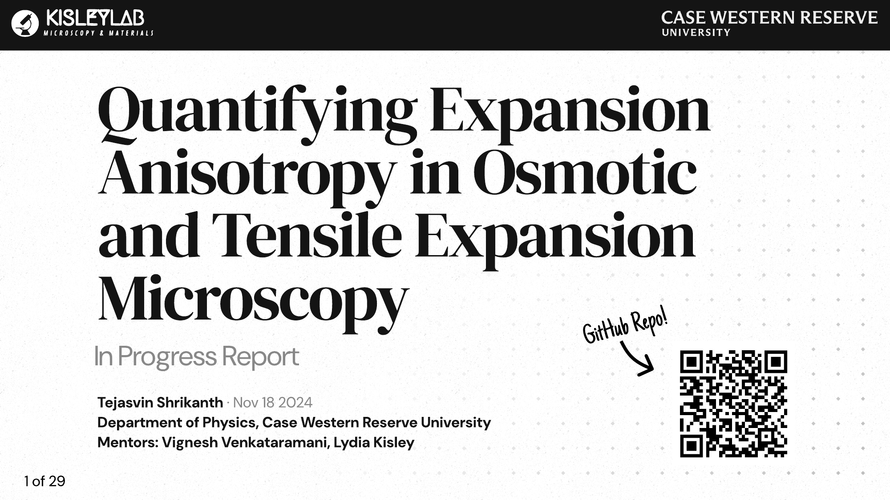

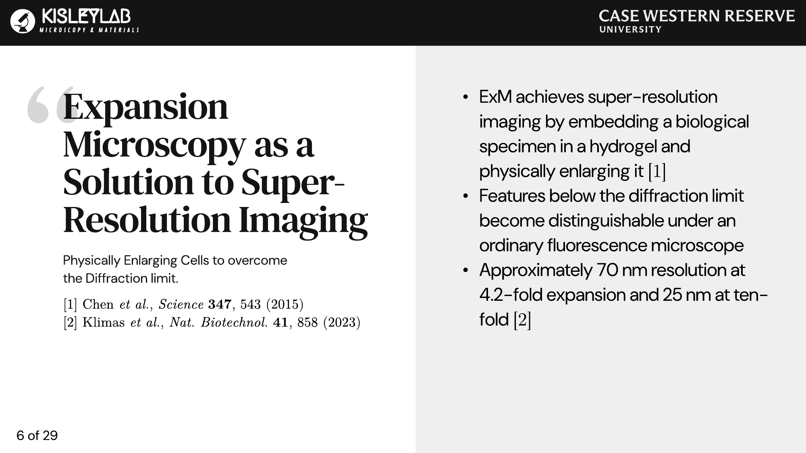

Expansion microscopy embeds a specimen in a hydrogel and enlarges it physically, so features below the diffraction limit separate under an ordinary fluorescence microscope: about 70 nm resolution at 4.2× and 25 nm at ten-fold.

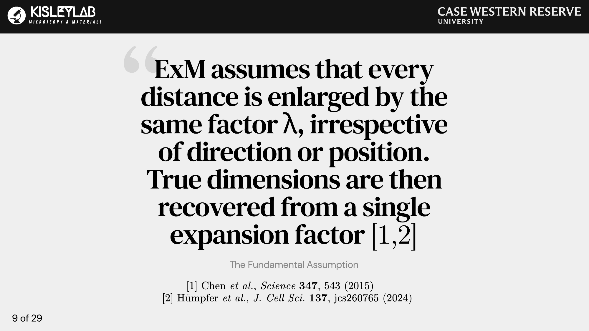

Every true dimension is recovered from a single expansion factor, which assumes every distance grows by the same factor whatever its direction or position. The project measures how far that holds, in osmotic and in tensile expansion.

## Magnify: the first bead-gel test

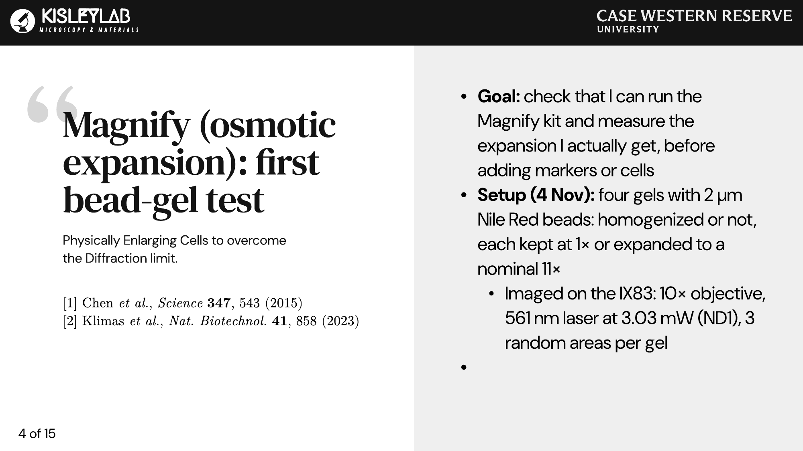

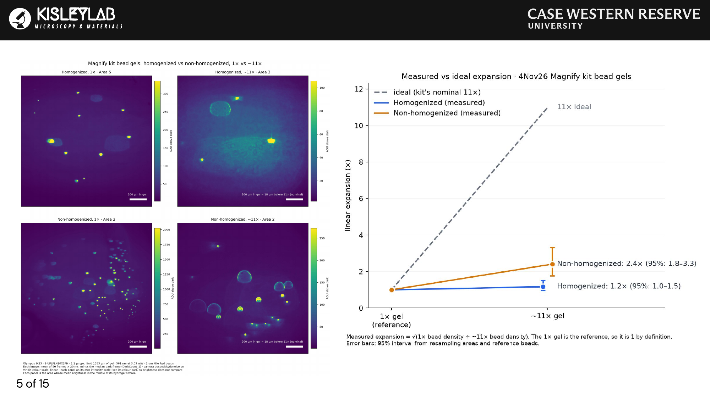

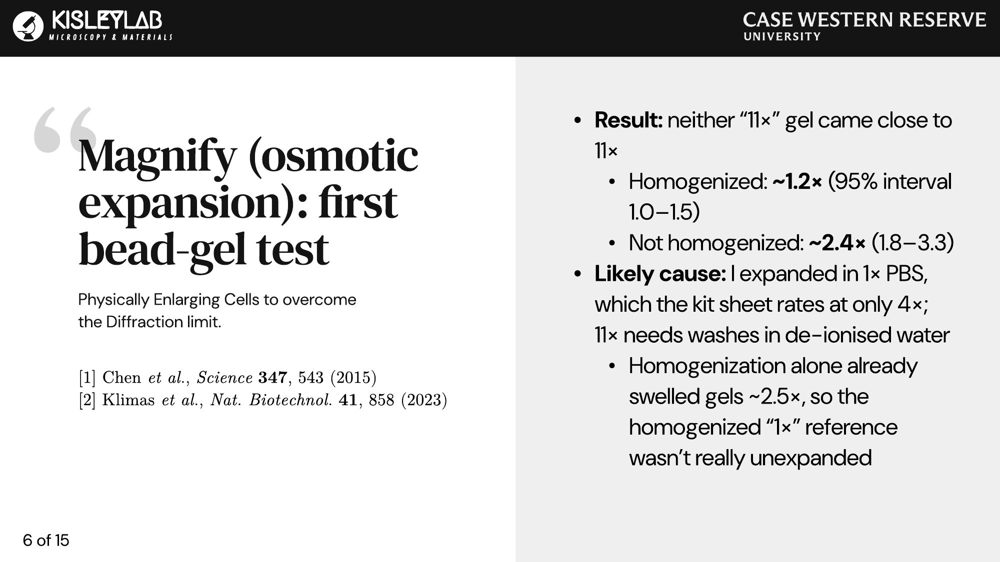

Four gels with 2 µm Nile Red beads, homogenised or not, kept at 1× or expanded towards the kit's nominal 11×, imaged on the IX83 at 561 nm. Neither "11×" gel came close: about 1.2× homogenised and 2.4× not. The likely cause is expanding in PBS, which the kit sheet rates at only 4×; 11× needs washes in de-ionised water. Full write-up in [the bead-gel post](2026-11-09-magnify-kit-bead-gels.md), and the second batch in [the follow-up](2026-11-17-magnify-second-batch-coverslip-sandwich.md).

## TExM: learning the IX83

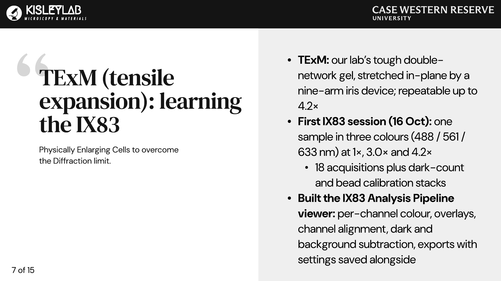

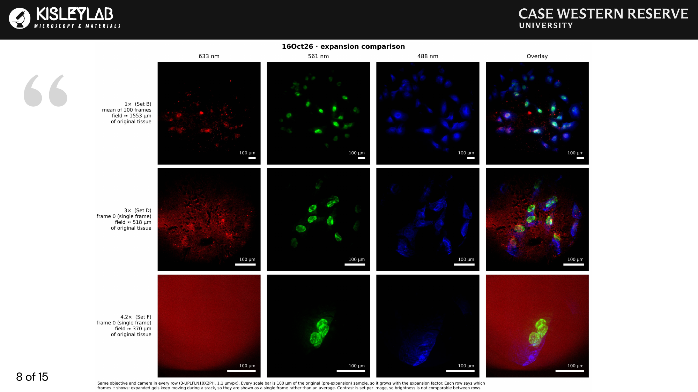

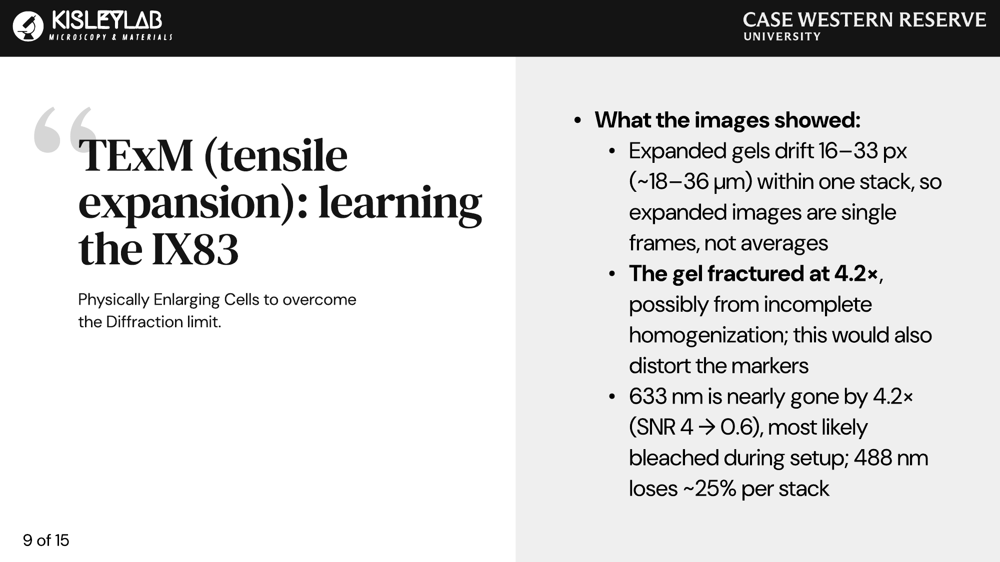

TExM is the lab's tough double-network gel stretched in-plane by a nine-arm iris, repeatable to 4.2×. The first IX83 session on 16 October imaged one sample in three colours at 1×, 3.0× and 4.2×, and led to the [IX83 viewer](../projects/ix83-viewer/). Expanded gels drift within a stack, so expanded images are single frames; the gel fractured at 4.2×, possibly from incomplete homogenisation; and the 633 nm channel was nearly gone by 4.2×, most likely bleached during setup. See [the IX83 post](2026-11-03-learning-the-ix83.md).

## The fiducial marker system

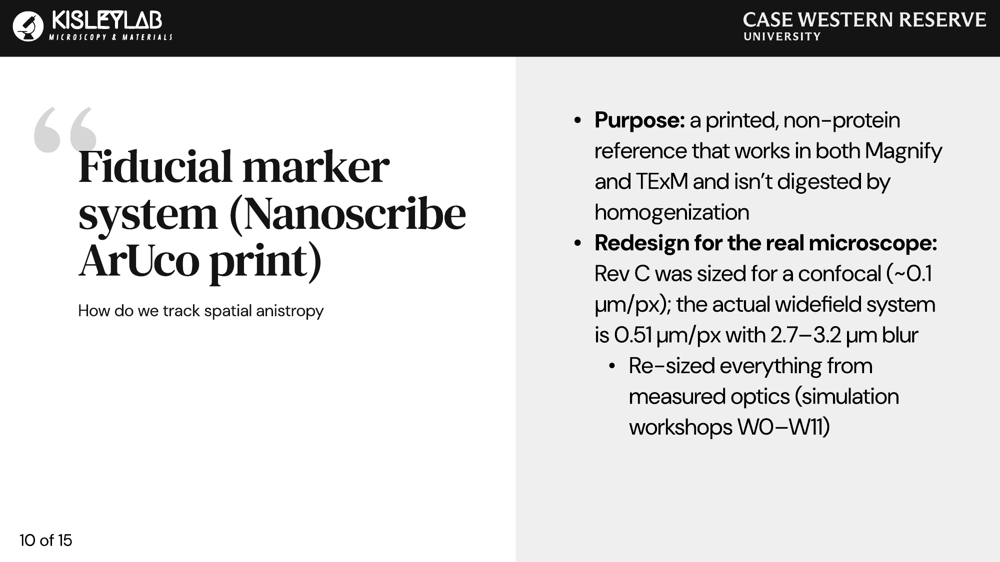

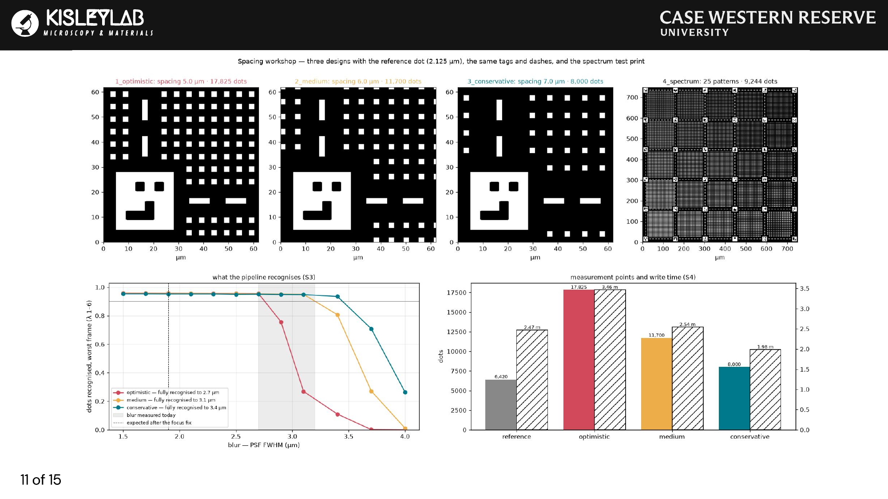

A printed, non-protein reference that works in both Magnify and TExM and is not digested by homogenisation. The earlier design was sized for a confocal at about 0.1 µm per pixel; the widefield system is 0.51 µm per pixel with 2.7 to 3.2 µm of blur, so everything was re-sized from measured optics. Three candidate designs and a spectrum test print came out of the [sizing workshop](2026-10-13-nanoscribe-marker-workshop.md).

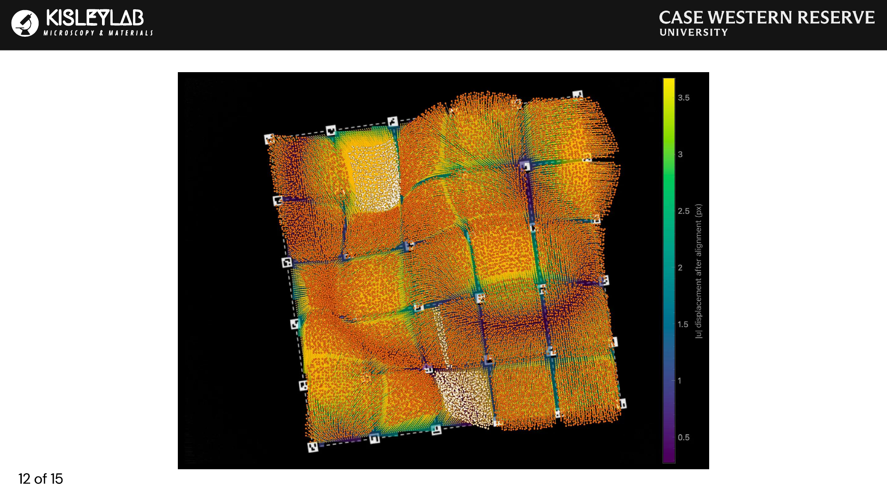

A displacement field after rigid alignment, from the [Reference-Warp Tagger](../projects/reference-warp-tagger/) on the earlier glyph print. This is what the ArUco version will produce with every point identified automatically.

## Measuring local anisotropy by cross-correlation (simulated)

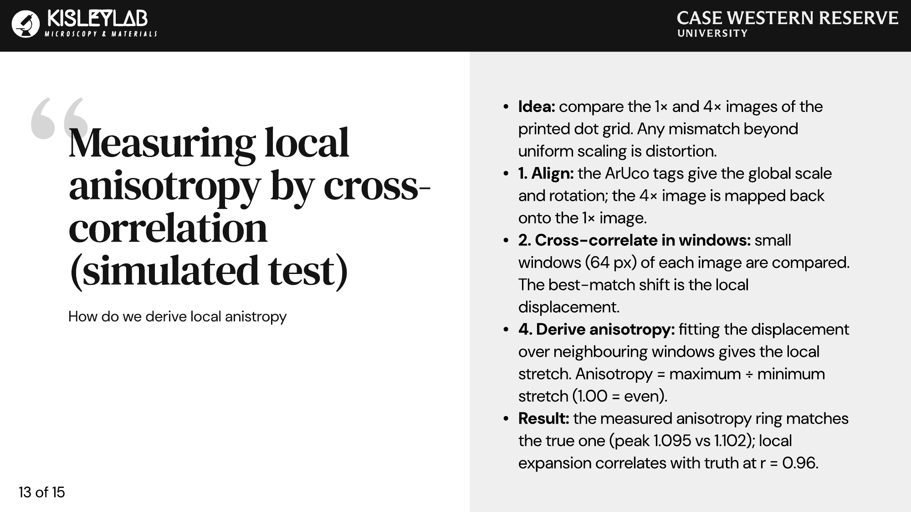

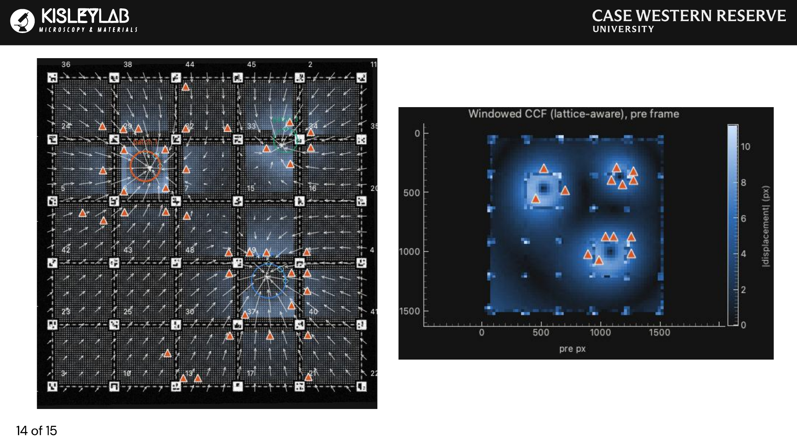

Align the 4× image onto the 1× image using the tags, cross-correlate small windows to get the local displacement, and fit the displacement over neighbouring windows to get the local stretch. Anisotropy is the maximum stretch divided by the minimum. In simulation the measured anisotropy ring matched the true one (peak 1.095 against 1.102) and local expansion correlated with truth at r = 0.96. This is a test of detectability on simulated images, not a measurement on a gel; see [the test workshop post](2026-10-30-test-workshop-spatial-structure.md).

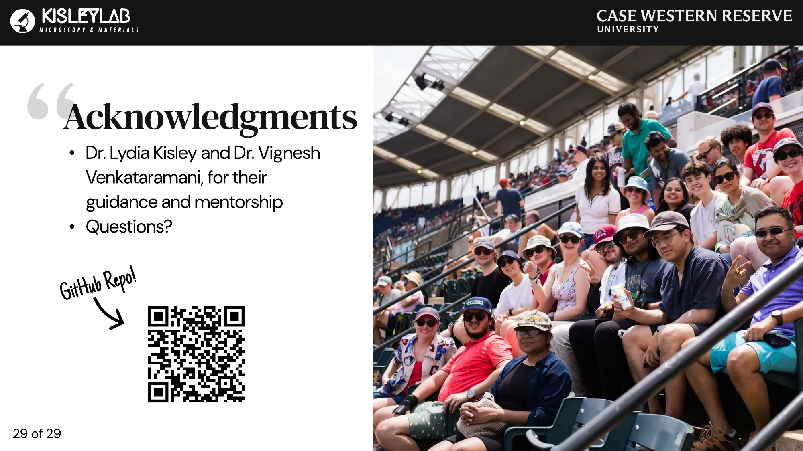

## Next

Get the Magnify gels to expand fully in water, send the ArUco design to the Nanoscribe, and image the first printed markers in both gels.
