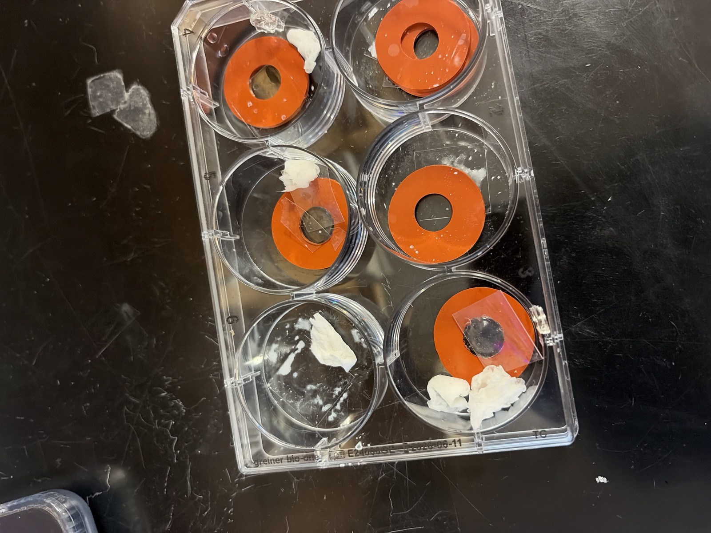

# A de-ionised water expansion that never happened: the last three gels had dried out

*2026-11-19*

A short session on 19 November, written up because the reasoning matters more than the outcome. The plan was to take the three gels left over from the [10 November batch](2026-11-17-magnify-second-batch-coverslip-sandwich.md) and expand them properly: fifteen minutes in PBS, then thirty to forty-five minutes in de-ionised water, instead of the forty-five minutes in PBS that the earlier gels got. The gels had dried out in their plate, so nothing was expanded.

The raw lab notebook (voice notes, transcript and a photo) is in [`lab-notebook/2026-11-19-magnify-kit-expansion-to-11x-with-di-water/`](../lab-notebook/2026-11-19-magnify-kit-expansion-to-11x-with-di-water/).

## What I meant to test

Two batches of Magnify bead gels have now reached only about 1.2 to 2.4× against the kit's nominal 11×. Two things in the protocol stand out:

- **The expansion liquid.** The kit's website says that reaching 11× takes a series of immersions in PBS, or immersion in de-ionised water. Both earlier batches were expanded in 1× PBS alone, which the kit sheet rates at about 4×. Water was the obvious thing to try next.
- **The skipped staining step.** Both batches skipped the kit's staining step, since there were no cells to stain. I wondered whether the staining washes themselves contribute to the swelling, and whether skipping them is part of why the gels stay small. That is a question to test later with a stained and an unstained gel side by side.

## What I found

The three gels had been in the six-well plate since 10 November. The plate was not sealed well enough, and by 19 November the gels were dry and taut on their coverslips, with only residue left in the wells. Nothing could be expanded, so I cleaned the plate and the silicone rings and ended the session.

## Next

Cast a new batch and keep it sealed, which happened [the next day](2026-11-20-magnify-tissue-kit-gels-thin-spacers.md). Meanwhile, read up on what others have run into with the Magnify cell culture kit that could explain the low expansion, and start on the Nanoscribe setup for printing the ArUco markers and transferring them into the TExM gel.
