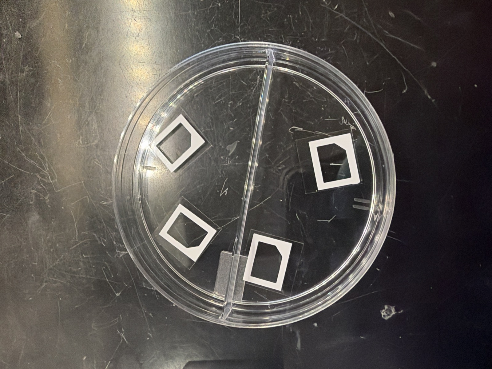
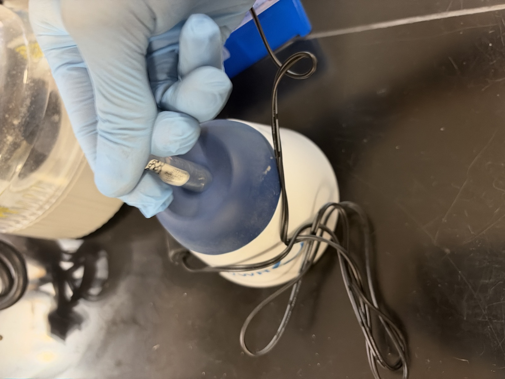
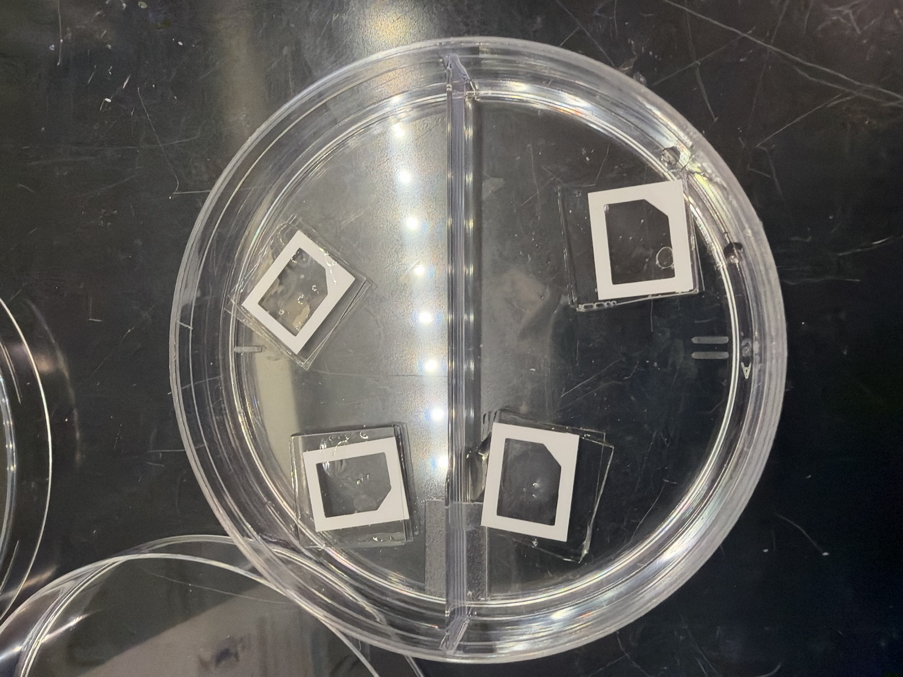

# Casting Magnify tissue-kit gels with the kit's own spacers: four thin gels ready to expand

*2026-11-20*

> **Update, 24 November:** these gels did not fully polymerise, most likely because the sticker moulds are thin and the top coverslip never sealed. A new batch was cast on 24 November in both sticker moulds and silicone rings; see the [lab notebook](../lab-notebook/2026-11-24-magnify-tissue-gels-silicone-and-sticker-moulds/).

After the [second bead-gel batch](2026-11-17-magnify-second-batch-coverslip-sandwich.md) still reached only about 1.2× and the three leftover gels [dried out](2026-11-19-magnify-di-water-attempt-gels-dried.md) before they could be tried in de-ionised water, I cast a fresh batch on 20 November from the Magnify kit for fixed tissue. Two things changed: the gels are much thinner, cast on the kit's own adhesive spacer stickers instead of silicone rings, and the activation buffer was vortexed for two minutes instead of about fifteen seconds. The expansion attempt comes on Monday 23 November, so there is no result yet.

The raw lab notebook (voice notes, transcripts and photos) is in [`lab-notebook/2026-11-20-magnify-tissue-kit-gels-preparation/`](../lab-notebook/2026-11-20-magnify-tissue-kit-gels-preparation/).

## Why thinner gels

Every gel so far has sat in a silicone ring, which fixes its thickness at the ring's height. My working guess is that this thickness is part of what holds the expansion back. The tissue kit ships with thin adhesive spacers, square stickers with a square window, meant to be stuck to a coverslip so the gelling solution fills the window. Using them makes the gel only as thick as the sticker.

## Making the gelling solution

The kit's gelling solution is made from two bottles, solution G and solution A, plus an activation tube:

1. Pipette 500 µL of solution G into an empty 2 mL Eppendorf tube.
2. Pipette 600 µL of solution A into the kit's activation tube and vortex. This time I vortexed for about two minutes to make sure everything dissolved. In the earlier batches it was about fifteen seconds, and I don't know whether that mattered.
3. Pipette 25 µL of the activation buffer into the 500 µL of solution G and mix gently with the pipette. That is the activated gelling solution, and it starts to gel on its own after roughly fifteen minutes, so the casting has to follow straight away.

## Casting

I pipetted 100 µL of activated gelling solution into the window of each spacer and laid a second coverslip on top, so each gel is sandwiched between two coverslips with the sticker as the spacer. Three of the four sandwiches picked up an air bubble because I slid the top coverslip across the bottom one while placing it. The fourth has no bubble. Next time the top coverslip goes straight down and is not moved.

The dish went into the incubator at 37 °C at 2:39 PM for two hours (the kit also allows 45 °C for an hour and a half), with a damp Kimwipe in the dish so the gels don't dry. At 4:35 PM I moved the dish to the fridge at 4 °C, where it stays until Monday.

## Next

On Monday 23 November: detach the gels from the coverslips, homogenise, and try to expand them to 11×, this time with the de-ionised water washes that the 19 November notes say the kit needs. If the thin gels get closer to 11× than the ring-cast ones, the thickness was part of the problem. If they don't, the next suspect is the expansion liquid alone, and that can be tested on the same gels.
