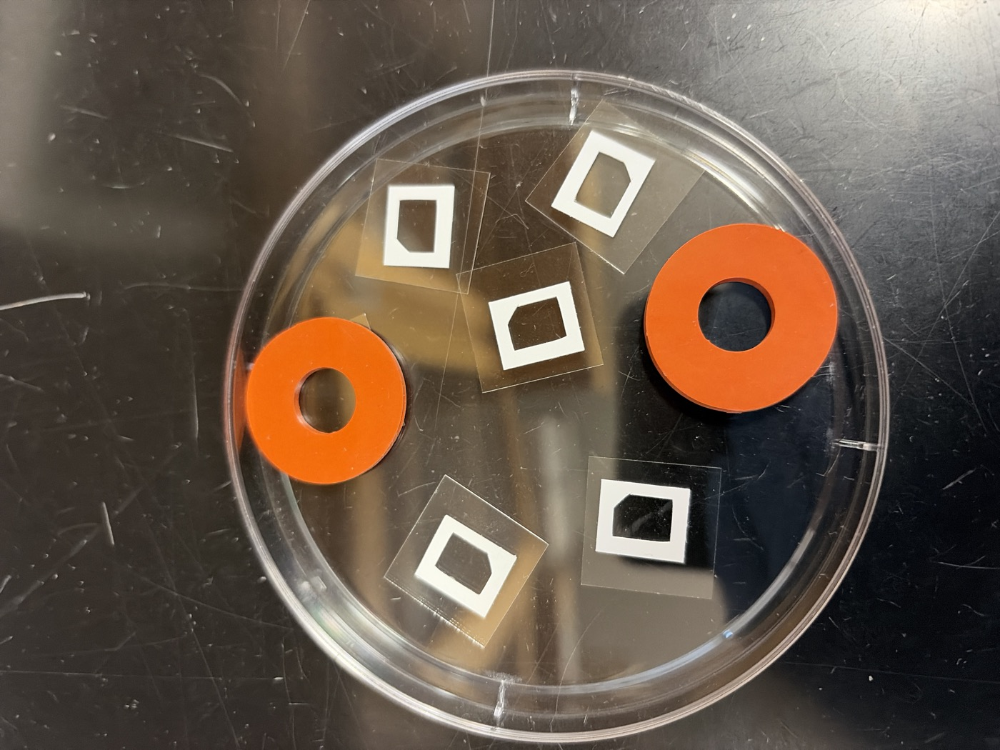
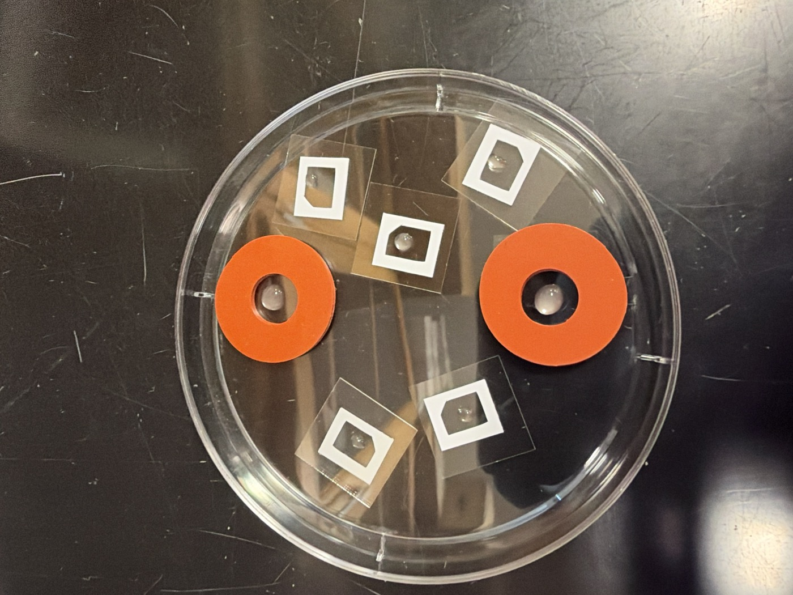
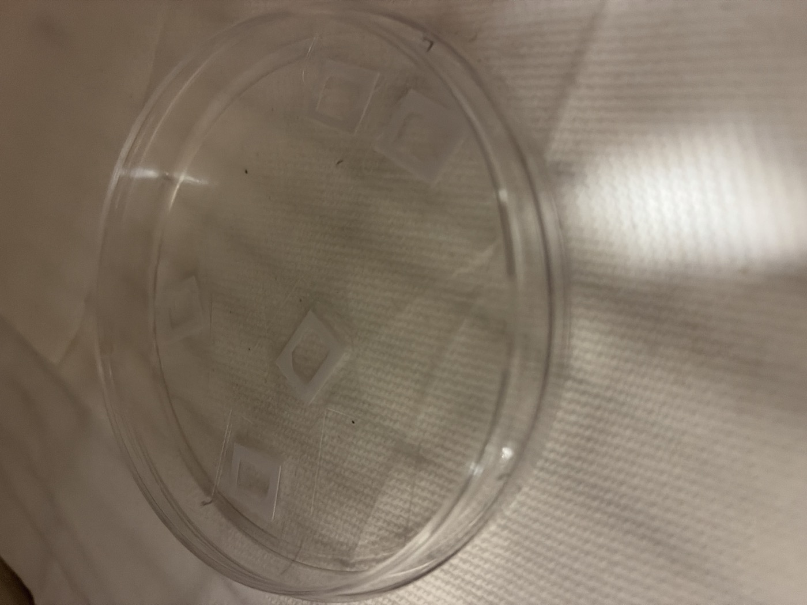
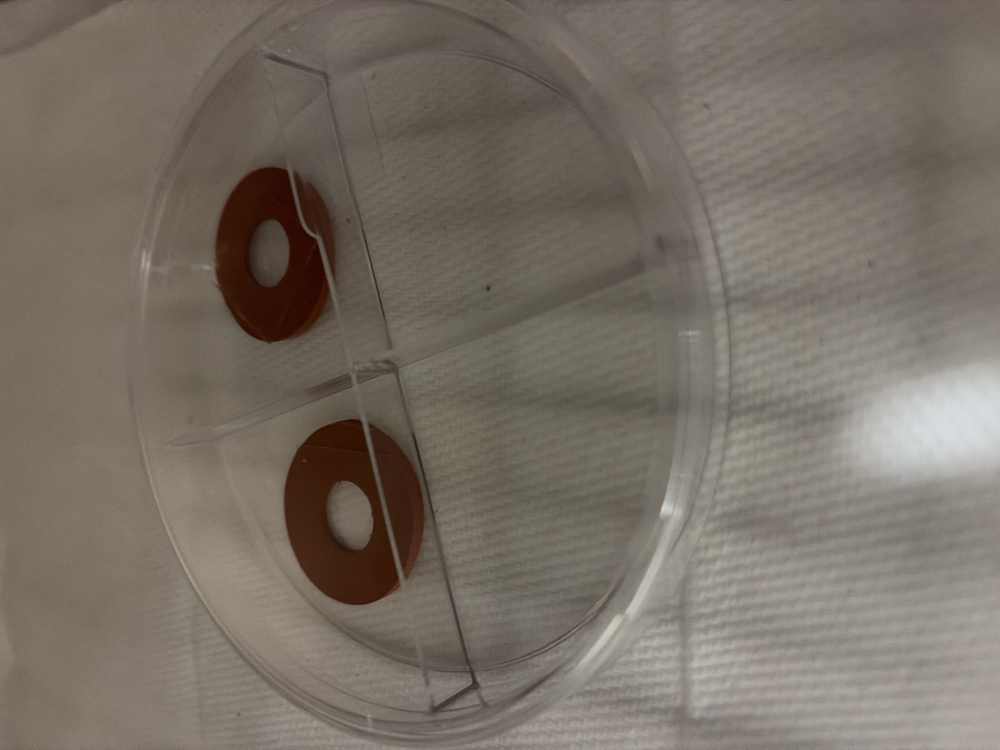
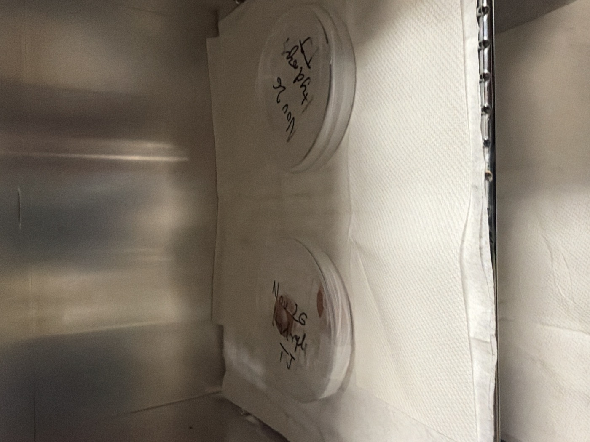
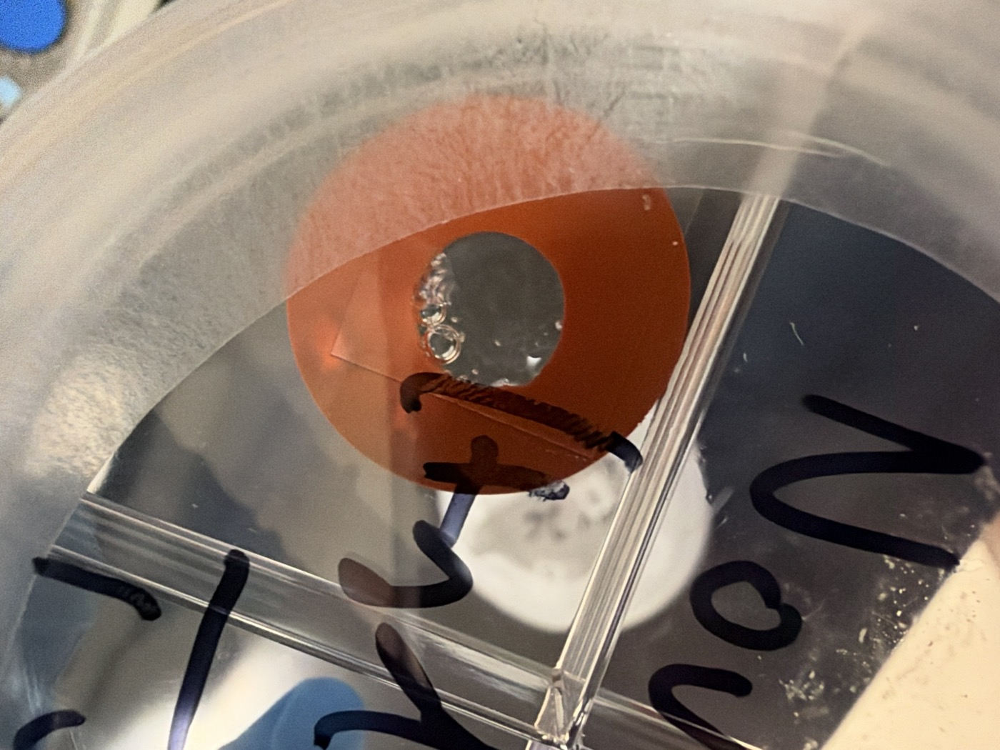

# Getting Magnify gels to 11×: thinner gels, and the gels that then refused to set

*2026-11-25 · DRAFT: the 24 November casting is written up; the 25 November homogenisation and expansion results are still to be added.*

Three weeks of Magnify bead gels have produced gels that expand to about 1.2 to 2.4× against the kit's nominal 11× ([first batch](2026-11-09-magnify-kit-bead-gels.md), [second batch](2026-11-17-magnify-second-batch-coverslip-sandwich.md)). This post lays out the two things I think are holding the expansion back, and the new problem that appeared as soon as I tried to fix one of them: gels cast in the kit's own thin moulds don't polymerise. Lab notebooks: [19 Nov](../lab-notebook/2026-11-19-magnify-kit-expansion-to-11x-with-di-water/), [20 Nov](../lab-notebook/2026-11-20-magnify-tissue-kit-gels-preparation/), [24 Nov](../lab-notebook/2026-11-24-magnify-tissue-gels-silicone-and-sticker-moulds/).

## Two suspects for the missing expansion

**1. The expansion liquid.** Both batches were expanded in 1× PBS, which the kit sheet rates at about 4×. The kit's website says 11× takes a series of immersions in PBS, or immersion in de-ionised water. So far no gel has had a proper water expansion: the [19 November attempt](2026-11-19-magnify-di-water-attempt-gels-dried.md) found the last three gels dried out before they could be tried.

**2. The gel is too thick.** Every gel so far was cast in a silicone ring, so each one is as thick as the ring. A thick gel swells in all three directions, and the top and bottom faces can constrain how far it spreads in the plane. The wrinkling seen on the earlier gels fits this: a gel that wants to grow in-plane but can't do so freely buckles instead. A thin gel has much less of this constraint. The kit ships with thin adhesive spacer stickers for exactly this reason, so the fix seemed simple: cast on the stickers instead of the rings.

## Going thin created a new problem: the gels did not set

The [20 November batch](2026-11-20-magnify-tissue-kit-gels-thin-spacers.md) was cast on the kit's stickers, sandwiched between two coverslips. When I came back to them the gelling solution had not fully polymerised. Four possible causes, in the order I rate them:

1. **The coverslips never sealed (most likely).** The sticker is adhesive on one side and slick on the other. The bottom coverslip sticks; the top one just rests on the slick face and slides at the slightest touch. Without a seal the thin film of solution is exposed to air, which stops the free-radical polymerisation. On 24 November I tried clips to press the sandwich together, but every attempt to position a clip moved the top coverslip and dragged in air bubbles, so I took the clips off. Next time: a small weight placed straight down on the top coverslip, so gravity makes the seal and nothing slides.
2. **The kit's mould is too thin (unlikely).** The stickers are what the kit is designed around, so the thickness itself should be fine. But it is the one variable that changed between the ring gels that set and the sticker gels that did not, so it needs ruling out rather than assuming.
3. **Not enough incubation (unlikely).** The gels had the full two hours at 37 °C that the kit asks for.
4. **A control to separate 1 from 2.** On 24 November two gels were cast in the thick silicone rings alongside five in the stickers, same solution, same incubator, same timing. If the ring gels set and the sticker gels don't, the thin mould or its seal is the problem. If neither sets, something else in the solution or the timing is wrong.

## The 24 November casting

Five sticker moulds and two silicone rings, each on an 18 mm coverslip.

Each mould got a drop of 2 µm Nile Red beads first, from a 1:100 dilution of the stock (2 µL stock in 198 µL water): about 20 µL into each ring and about 2 µL into each sticker window. The drops were dried at about 50 °C for twenty minutes so the water would not dilute the gelling solution.

The gelling solution was made as before: 500 µL of solution G in a 2 mL tube, 600 µL of solution A vortexed in the activation tube, 25 µL of that into the solution G, used within fifteen minutes. About 200 µL went into each silicone ring, where the top coverslip sealed without trouble. The sticker moulds were the ones that would not seal, as described above, and two or three of the five ended up with bubbles.

One step was done out of order. The kit wants the filled moulds in the fridge at 4 °C for 20 to 45 minutes before the incubator, to let the solution infiltrate. I put the dishes straight into the incubator, noticed a few minutes later, and moved them to the fridge for fifteen minutes. Both dishes were then sealed with parafilm so nothing dries out, and incubated at 37 °C for an hour and a half, the kit's minimum.

At the end of the day the gels went into the fridge at 4 °C for the night. One silicone-ring gel had a cluster of bubbles that still moved when the dish was tilted, which means that gel at least was not fully set. The other ring gel and the sticker gels without bubbles looked fine.

## 25 November: what happened

*To be written from the 25 November notebook: which gels set, the homogenisation, the PBS and de-ionised water expansion, and the measured sizes.*

## Next

*To be written once the 25 November results are in.*
