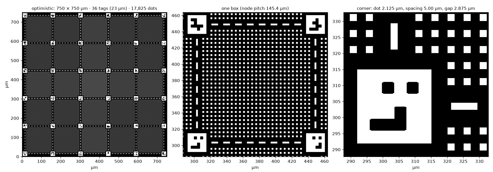

# ArUco marker design

Design of the fiducial print for the Nanoscribe: a 750 × 750 µm field of 5 × 5
boxes with ArUco tags at the 36 grid nodes, dashes on the box boundaries and a
5 µm-pitch dot lattice filling each box. The design is sized against the
microscope's measured point-spread function and validated end to end through a
camera simulator before anything is printed.

## Folders

- `docs/`: the [implementation plan](docs/IMPLEMENTATION_PLAN.md) and one
  document per phase (0: measurements of the microscope, A: pattern generator,
  B: simulator, C: detector, D: end to end), with the run logs and figures each
  phase produced.
- `tools/`: the scripts. `aruco_grid.py` generates a design and its STL;
  `make_dummy_series.py` renders expansion series with known truth for the
  tagger's tests; `s3_recognition.py`, `s4_printability.py` and `s5_gate.py` are
  the gates a candidate design must pass; `phase_c_verify.py` and
  `phase_d_end_to_end.py` are the validation runs.
- `sim/`: the camera model (PSF, pixel sampling, noise, vignetting, lens distortion).
- `designs/`: the three gated candidates, `1_optimistic` (23 µm tags),
  `2_medium` (27 µm) and `3_conservative` (34 µm), plus `4_spectrum`, a test
  print with several sizes side by side. Each has its render, spec sheet,
  `reference_tags.json` and STL.
- `final_design/`: the chosen optimistic design and its one-figure validation.
- `cad/`: STL exports for the Nanoscribe.
- `workshop/`: the October 2026 sizing workshop, see the
  [blog post](../../blog/2026-10-13-nanoscribe-marker-workshop.md).
- `dummy/`: the dummy series presets. Frames and per-feature truth CSVs are
  regenerated, from this folder's parent, with
  `python projects/aruco-marker-design/tools/make_dummy_series.py --preset all`.

Several scripts import from `../reference-warp-tagger`, so keep the two folders
side by side.
